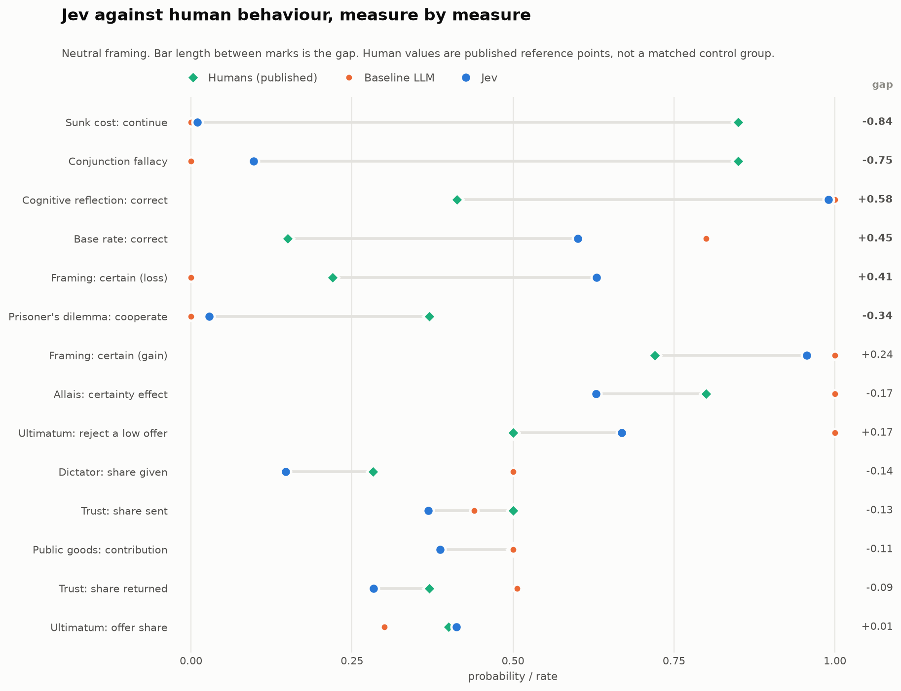
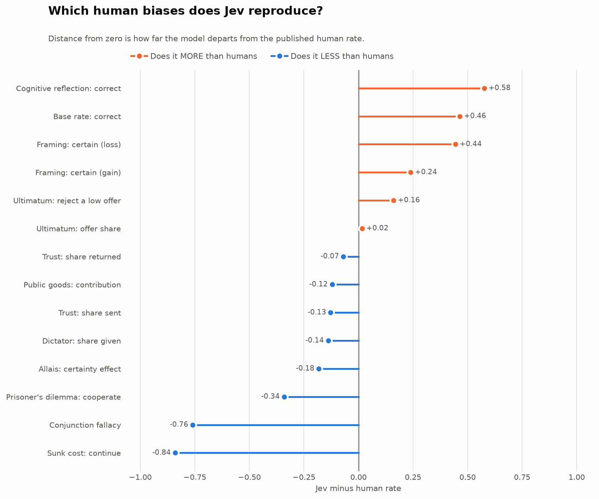
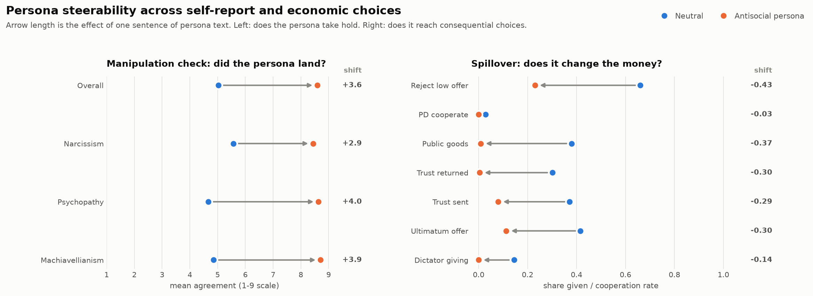
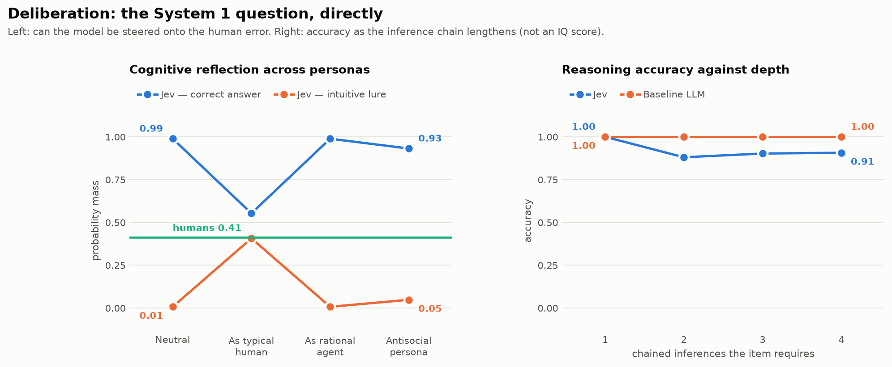
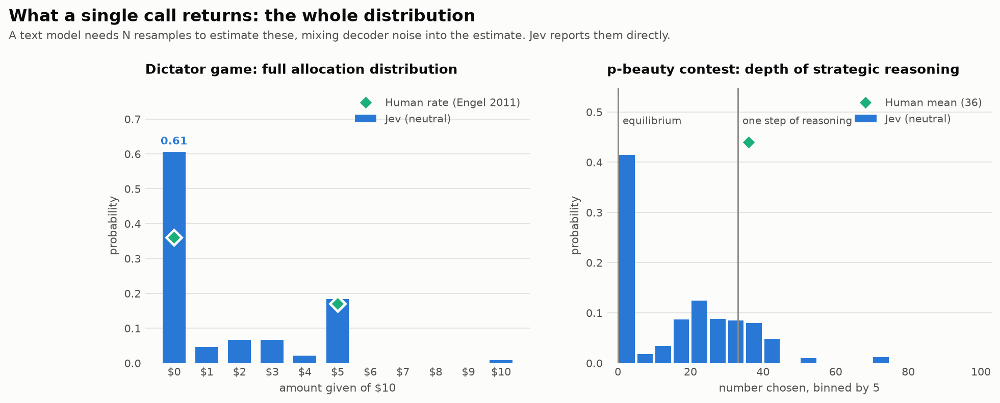
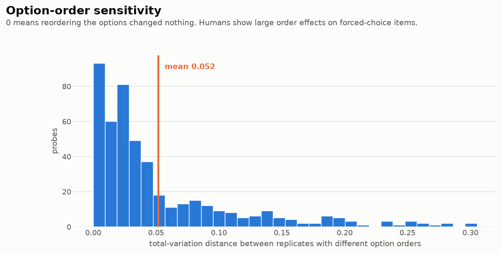

# Does a "System One" model behave like human System 1?

A behavioural-economics and psychometric battery run against TypeSafe's Jev,
with an ordinary chat model and published human values as comparison points.

> [!IMPORTANT]
> **This is a personal project, done out of curiosity and to learn how to build
> an evaluation.** It is not research, not a product review, and not the work of
> anyone with professional standing in psychometrics, experimental economics or
> model evaluation. **No claims are made** about any model, company or product.
> What follows is a set of numbers recorded from a public API on one day in
> September 2026, and a description of how they were produced. Everything is
> recomputable from `data/raw/`. It is not peer reviewed, it uses instruments
> well outside the contexts they were validated in, and it is probably wrong
> somewhere — two real bugs were already found and fixed mid-project. Full
> caveats in [PREREGISTRATION.md](PREREGISTRATION.md#what-this-is-and-what-it-is-not).
> Not affiliated with or endorsed by anyone. Corrections welcome.

---

## The question

TypeSafe describes Jev as a **System One model**: it returns a typed,
probabilistic decision in a single pass rather than generating text token by
token.

That name comes from dual-process theory. In Kahneman's framing, System 1 is
fast, automatic and associative; System 2 is slow and deliberate. Most classic
results in behavioural economics are demonstrations that human System 1 produces
confident, systematic, *predictably wrong* answers where deliberation would
produce right ones.

So there is a question that is at least fun to ask: **does a model that is
architecturally System 1 — one forward pass, no chain of thought — reproduce the
behavioural signature of human System 1?** And if you simply *ask* it to answer
like a person, what happens?

## Why this model is an unusually convenient subject

Work of this kind normally has to estimate how a model would answer by
resampling the same prompt many times at temperature and counting outcomes. That
estimate mixes the model's response tendency with the sampler's noise, and costs
N calls per item.

Jev returns a **probability distribution over the answer set in one call**. So
every number here is computed from the returned distribution, never from the top
answer — discarding the distribution would throw away the only reason this was
worth doing.

The contrast showed up in the run itself. The comparison arm, resampled ten
times per item, mostly returned saturated estimates — 0.00 or 1.00 — because ten
draws from a confident model rarely disagree. Jev returned graded probabilities
for the same items, at **$0.08 against $2.58** for the identical grid. (That
saturation is partly an artifact of only ten samples; it is not evidence that the
chat model's underlying distribution is degenerate.)

## What I observed

9,360 observations, 0 transport errors, $2.67 total. 117 probes × 4 persona
conditions × 10 replicates, plus the same grid through `claude-sonnet-5`.
Full tables in [docs/RESULTS.md](docs/RESULTS.md).

### Under neutral framing it does not look like human System 1



On most classic biases it sits closer to the normative answer than the published
human value. It answered the Cognitive Reflection Test at **0.99** probability
mass on the correct answers (human reference ≈ 0.41), with **0.01** on the
intuitive lures that the items are built to attract. It continued a losing
project in the sunk-cost item with probability **0.01** (human ≈ 0.85), got the
base-rate item's correct band at **0.60** (human ≈ 0.15), and moved **1.2
percentage points** between anchoring conditions where humans move about 20.



The social preferences are the exception: it gave **0.15** of the pie as
dictator, offered **0.41** in the ultimatum game (human ≈ 0.40) and rejected low
offers at **0.67**. Positive giving is not equilibrium play, so on these items it
does land near people rather than near game theory.

### Asked to answer like a person, it moves a long way




One sentence — *answer the way a typical human participant would actually
answer* — moved CRT accuracy from **0.99 to 0.55** and lure mass from **0.01 to
0.41**. Sunk-cost continuation went from **0.01 to 0.80** against a human
reference of 0.85. The conjunction fallacy went from **0.10 to 0.93** against
0.85. Whatever else that is, the model has a usable representation of how people
get these problems wrong.

The other two conditions move it just as far in their own directions. Asked to
answer as a rational agent, it put **all** its mass on giving nothing in the
dictator game and **all** of it on the Nash equilibrium of 0 in the p-beauty
contest. Asked to adopt an antisocial persona, Dark Triad self-report rose from
**5.0 to 8.6** on a 9-point scale (the manipulation check), and giving collapsed
across every game — dictator 0.15 → 0.00, trust sent 0.37 → 0.07, public goods
0.39 → 0.01.

That the persona reaches consequential allocations and not just self-description
is the part I found most interesting, and it is measurable here only because the
output is a number.

### Where I was wrong

Four of my recorded expectations did not survive, which I am reporting because
the point of writing them down first was to be held to them.

| Expected | Observed |
|---|---|
| Framing reversal much weaker than humans (< 25 points) | **33 points** — weaker than the human ~50, but larger than I predicted |
| Independently elicited probabilities obey P(A∧B) ≤ P(A) | **Violated**, margin **−0.09** under neutral framing and **−0.39** when asked to answer like a person |
| Accuracy falls as reasoning depth grows (> 15 points) | **10 points** from 1-step to 3+-step items under neutral framing |
| Option order barely matters (mean TV < 0.05) | **0.051** mean, median 0.028 — small, but above the line I drew |

The conjunction result looked like the most interesting thing here until I read
the documentation properly. Asked side by side, the model picked the single
statement over the conjunction (fallacy mass 0.10). Asked as two independent
probability questions, it assigned the conjunction *higher* probability than its
own component. That is the shape of the original human finding — but it is also
already documented behaviour, not a discovery. See the next section.

## Checked afterwards against the documented behaviour

After the run I read TypeSafe's `model-jaggedness/jev-1.13` page, which
documents known weaknesses of this version. Three of them bear directly on
results above, and reading it earlier would have changed how I designed the
battery.

**"Jev is not a calculator… does not count reliably."** A large part of this
battery is arithmetic: all six CRT items, the number-series and quantitative
reasoning items, the Holt–Laury lottery comparisons, the discounting items, the
base-rate problem and the p-beauty contest. Wherever the model did *badly* on
those, "documented numeric weakness" is at least as good an explanation as
anything about System 1, and probably better. **The Holt–Laury result — 2.0 safe
choices against a human reference of 5.2, which would read as strongly risk
seeking — should not be taken at face value**, because it depends on comparing
probabilities and payoffs numerically. The same caution applies to the
discounting items.

It cuts the other way too: the model answered a set of arithmetic word problems
at 0.99 despite arithmetic being a documented weak spot, which makes the
cognitive-reflection result more interesting rather than less.

**"There are many structural invariants one might imagine to hold that simply
aren't guaranteed."** This covers the conjunction-rule violation directly. I
predicted the axiom would hold; the documentation says in advance that such
invariants are not guaranteed. So the finding is consistent with documented
behaviour, and my expectation was simply naive. Presenting it as a surprise
would have been the genuinely embarrassing outcome.

**"Content written to adversarially steer the model… can move the answer."** The
persona-steerability result is likewise consistent with documented behaviour
rather than novel. What this repository adds is a measurement of *how far* it
moves on consequential allocations, not the observation that it moves.

**A guidance violation of my own.** The Score docs say to *"describe situations,
not degrees"*, and warn that each level is judged independently so comparative
language does not help. Every Likert scale here is degrees — "Very inaccurate"
through "Very accurate" — because that is what the instruments specify. The
instrument and the primitive's guidance genuinely conflict, and I followed the
instrument. Someone could reasonably argue I should have done the opposite.

**What did hold up.** The framing is not a misreading: the documentation states
that *"The System One name comes from the concept Daniel Kahneman popularized in
his book Thinking, Fast and Slow"*, and that these models do not "generate
explanations of their reasoning". The Score handling is also right — the score is
0-indexed and defined as each level multiplied by its probability and summed,
which is what `expected_level` computes.





## Running it yourself

```bash
git clone https://github.com/tynamite/system-one-behavioural-eval.git
cd system-one-behavioural-eval
uv venv && uv pip install -e ".[dev]"

cp .env.example .env        # then add your OpenRouter key
jevbench doctor             # verify credentials and endpoint

jevbench probes             # list the battery, call nothing
jevbench run --replicates 10 --baseline-samples 10
jevbench analyse
jevbench figures
```

**No key? Everything still works.** The offline backend is deterministic and
exercises the entire pipeline:

```bash
jevbench run --backend simulator --replicates 2
jevbench analyse && jevbench figures
```

Simulated output is structurally valid nonsense, tagged `simulated` in the
filename, and `load_records` refuses to pool it with live data.

Reproduce the analysis in this repo without spending anything — the raw
records are committed:

```bash
jevbench analyse --run data/raw/run_live_<timestamp>.jsonl
jevbench figures --run data/raw/run_live_<timestamp>.jsonl
```

## Repository layout

```
src/jevbench/
  schema.py        Choice / Score / Noul primitives; normalises all three
                   into one distribution-carrying Answer
  client.py        OpenRouter decisions route + native TypeSafe endpoint,
                   bounded backoff, key redaction on every error path
  simulator.py     deterministic offline backend for CI
  runner.py        concurrent execution, one JSONL record per observation
  analysis.py      statistics; both arms reduced to comparable distributions
  plots.py         figures
  benchmarks.py    28 human reference values, each with source + reliability
  instruments/     the battery
scripts/           doc generators, and the figure layout checker
tests/             59 tests, all runnable with no API key
data/raw/          committed raw records — every number is recomputable
results/           generated tables and figures
docs/              generated reference and results documents
```

## How the instruments map onto three primitives

Jev answers only in `Choice`, `Score` and `Noul`. That turns out to cover
almost every standard response format in the literature:

| Response format | Primitive | Example |
|---|---|---|
| Forced choice | `Choice` | accept/reject, cooperate/defect, which programme |
| Allocation | `Choice` over integers | give $0…$10 — returns the whole histogram |
| Likert | `Score` with 5 or 9 levels | Mini-IPIP, Dirty Dozen |
| Probability judgement | `Noul` | "Linda is a bank teller" |

What it cannot do: free text, reasoning traces, open-ended responses. Items
requiring those are simply not in the battery rather than being approximated.

## Methodology notes

**Distributions, not argmax.** Every statistic is computed from the returned
probabilities. For `Score` items, the expected level is recomputed from the
returned index weights rather than read from the scalar `score` field, so all
instruments are treated identically.

**No answer-key leakage.** `Choice` option keys carry literal content
(`"$0.05"`, `"cooperate"`) and never evaluative labels. A test asserts this.

**Item isolation.** One probe per API call. Jev accepts many questions per
call, but batching would place items in a shared context; an administered
instrument requires them to be mutually blind.

**Order randomisation.** Option order is independently permuted per replicate,
which is what makes the order-invariance claim testable rather than assumed.

**Reverse-keyed items.** Each Big Five factor carries both forward and
reverse-keyed items, so answering the surface wording rather than the content
is detectable.

**Bugs found the hard way.** The comparison arm originally capped replies at 8
tokens, which truncated the chat model into returning null content on 490 of
4,680 calls — and not at random, but concentrated on the hardest items and the
most deliberative persona. Analysing that run would have compared Jev against a
baseline silently missing its worst cases. A second bug matched option text by
substring, so on the p-beauty contest, whose options are the integers 0–100, a
reply of `"100"` could resolve to `"1"`. Both are now regression-tested. The
committed run has **0 errors**; the flawed one was discarded, not patched.

## Limitations

The full version is in
[PREREGISTRATION.md](PREREGISTRATION.md#what-this-is-and-what-it-is-not). The
ones that bound the numbers most:

1. **Not expert work, and not peer reviewed.** A hobby project that tries to be
   careful. Instruments are used far outside their validated contexts by
   someone unqualified to validate them.
2. **The human values are not a control group.** They come from separate
   published samples with different populations, stakes, decades and protocols.
   Differences of a few points are not interpretable. Where the human result is
   a *contrast* (the framing reversal, the anchoring gap), the contrast is the
   robust quantity, not the level.
3. **A model is not a participant.** Self-report items were written for people
   with autobiographies. "Do you have frequent mood swings" is not the same
   question when asked of software, and the Dark Triad scale is a manipulation
   check, never a diagnostic claim.
4. **The reasoning set is not an IQ test.** No norms, no standardisation
   sample; it reports accuracy on a fixed list of questions.
5. **One model, one route, one day.** `jev-1.13` through a third-party gateway
   in September 2026, via an alpha route that may move. `jevbench doctor` is
   there to say when it has.
6. **Persona conditions are prompt manipulations**, not traits. They show what
   the model can be induced to output, and nothing about what it "is".
7. **The reasoning items were written for this project** and have no
   psychometric validation. Published instruments are used where a free one
   exists, and cited.
8. **Results move a lot with wording.** Several headline numbers shift
   substantially across the four framings, which is itself a reason to be
   careful generalising from any single one of them.

## Instrument provenance

Every instrument here is public domain or free for research use — a hard
constraint for a public repository, and the reason the commercial inventories
do not appear.

| Instrument | Source | Status |
|---|---|---|
| Cognitive Reflection Test | Frederick (2005); Toplak et al. (2014) | published, widely reproduced |
| Mini-IPIP Big Five | Donnellan et al. (2006) | IPIP items are public domain |
| Dark Triad Dirty Dozen | Jonason & Webster (2010) | free for research use |
| Fluid reasoning | authored here, in ICAR format (Condon & Revelle 2014) | original items, no norms |
| Economic games | Güth et al. (1982); Forsythe et al. (1994); Berg et al. (1995); Fehr & Gächter (2000) | paradigms, wording written here |
| Decision anomalies | Kahneman & Tversky (1979, 1981, 1983, 1974); Arkes & Blumer (1985) | classic problems, cited |
| Risk and time | Holt & Laury (2002); Thaler (1981) | published designs |
| Strategic games | Nagel (1995); Arad & Rubinstein (2012) | published designs |

Deliberately excluded: WAIS, Raven's APM, NEO-PI-R, 16PF, MMPI, PCL-R, PPI-R —
all copyrighted and not reproducible here.

## Security

This repository talks to a paid API and is public, so the key handling is
defensive by construction:

- the key is read from the environment only, never a literal in code
- `.env` is gitignored; a pre-commit hook refuses to commit one
- every error path runs the key through `redact()` before it reaches a log
- CI runs gitleaks and asserts that no `.env` and no key-shaped string is
  tracked

## Licence

MIT — see [LICENSE](LICENSE). Instrument sources retain their own terms; see
the provenance table above.
