# Does a "System One" model behave like human System 1?

A behavioural-economics and psychometric battery run against TypeSafe's Jev,
versions 1.13 and 1.14, with thirteen other models and published human values
as comparison points.

> [!IMPORTANT]
> **This is a personal project, done out of curiosity and to learn how to build
> an evaluation.** It is not research, not a product review, and not the work of
> anyone with professional standing in psychometrics, experimental economics or
> model evaluation. **No claims are made** about any model, company or product.
> What follows is a set of numbers recorded from public APIs between 12 and 15
> October 2026, and a description of how they were produced. Everything
> is recomputable from `data/raw/`. It is not peer reviewed, it uses instruments
> well outside the contexts they were validated in, and it is probably wrong
> somewhere. Full caveats in [PREREGISTRATION.md](PREREGISTRATION.md#what-this-is-and-what-it-is-not).
> Not affiliated with or endorsed by anyone. Corrections welcome.

---

## The question

TypeSafe describes Jev as a **System One model**: it returns a typed,
probabilistic decision in a single pass rather than generating text token by
token.

That name comes from dual-process theory. In Kahneman's framing, System 1 is
fast, automatic and associative; System 2 is slow and deliberate. Most classic
results in behavioural economics are demonstrations that human System 1 produces
confident, systematic, *predictably wrong* answers where deliberation would
produce right ones.

So there is a question that is at least fun to ask: **does a model that is
architecturally System 1 — one forward pass, no chain of thought — reproduce the
behavioural signature of human System 1?** And if you simply *ask* it to answer
like a person, what happens?

### Two versions of Jev

The study was preregistered and first run on **Jev 1.13**, the version
TypeSafe served as `jev-latest` on 12–13 October 2026. On 14 October TypeSafe
listed **Jev 1.14** as its `jev-preview` model, and the same 147-item battery
was run through it that day, with the same ten repeats and shuffled options
(the full-battery run of the [option-order
addendum](#addendum-14-october-2026-option-order)). Every item went under the
same five prompts but 15 of the follow-up study's population questions, which
the battery by then asked under the neutral prompt only: 6,850 calls against
1.13's 7,450. No comparison uses those 600 calls. Every result below gives
both versions, with two exceptions that are 1.13 only: the cost comparison
with the chat model (TypeSafe's direct API reports no cost for the 1.14 run)
and the preregistered hypothesis table. The preregistered tests were written
for 1.13 and are scored on it; 1.14's results for the same tests are given
after that table as a description, not a test.

## Why this model is an unusually convenient subject

Work of this kind normally has to estimate how a model would answer by
resampling the same prompt many times at temperature and counting outcomes. That
estimate mixes the model's response tendency with the sampler's noise, and costs
N calls per item.

Jev returns a **probability distribution over the answer set in one call**. So
every number here is computed from the returned distribution, never from the top
answer — discarding the distribution would throw away the only reason this was
worth doing.

The contrast showed up in the run itself, at **$0.14 against $8.84** for the
identical grid.

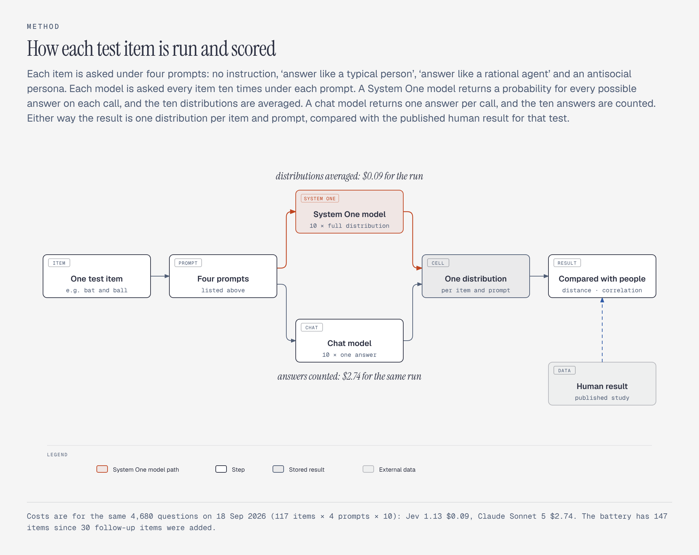

The comparison arm returns near-identical answers on most items: in 83% of its
cells all ten samples agreed. That is genuine low-entropy behaviour rather than
a defect — temperature is demonstrably active, and genuinely ambiguous items do
come back mixed. Two caveats follow that the cost comparison alone obscures.
Ten samples cannot resolve a probability finer than 0.1, and ten agreeing
samples license "at least 0.78" at 95% (a Jeffreys interval), not 1.00. And the arms do not measure
the same quantity: Jev reports a credence, whereas resampling recovers a
sampling frequency, and a model can be internally uncertain while emitting the
same token every time. The cost asymmetry is real; the graded-versus-saturated
contrast is partly an artifact of comparing two different things.

What one call returns, for the dictator game, next to what people give:

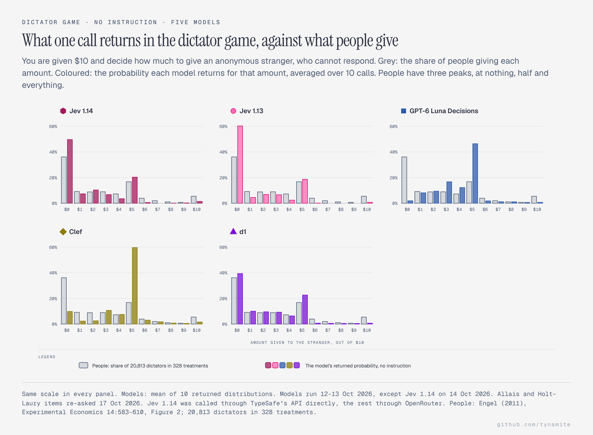

## What I observed

The main run is 14,800 observations at $8.99, recorded on 12–13 October 2026:
147 probes × 5 prompt conditions × 10 replicates through Jev 1.13, plus the
same grid through `claude-sonnet-5.5`, resampled ten times per cell, and 100
more calls on 13 October for the population questions added to the follow-up
study (see below). No transport errors; 3 of 6,800 scorable comparison-arm
replies (0.04%) could not be resolved to an option, and every cell kept at
least 8 of its 10 samples. Jev 1.14's run on 14 October is 6,850 calls with
no errors, through TypeSafe's API directly rather than OpenRouter; the
addendum found the route moves answers about as much as repeating the call
does. Full tables in [docs/RESULTS.md](docs/RESULTS.md).

Where a human value is quoted it is a published reference point, listed with
its source in [docs/BENCHMARKS.md](docs/BENCHMARKS.md). Two are looser matches
than the rest: the base-rate figure counts Bayesian answers rather than answers
in a band, and the anchoring study asked a different question, so only its
20-point gap between anchors is compared.

The charts put both Jev versions next to three other System One models from the
[model comparison](docs/MODELS.md) — GPT-6 Luna Decisions, Cloudflare's Clef
and Liquid AI's d1 — so Jev can be read against its peers. Each model keeps
its colour and shape in every chart; hollow marks are always the baseline
condition and filled marks the other. All fifteen models are in
docs/MODELS.md.

### With no instruction, it does not look like human System 1

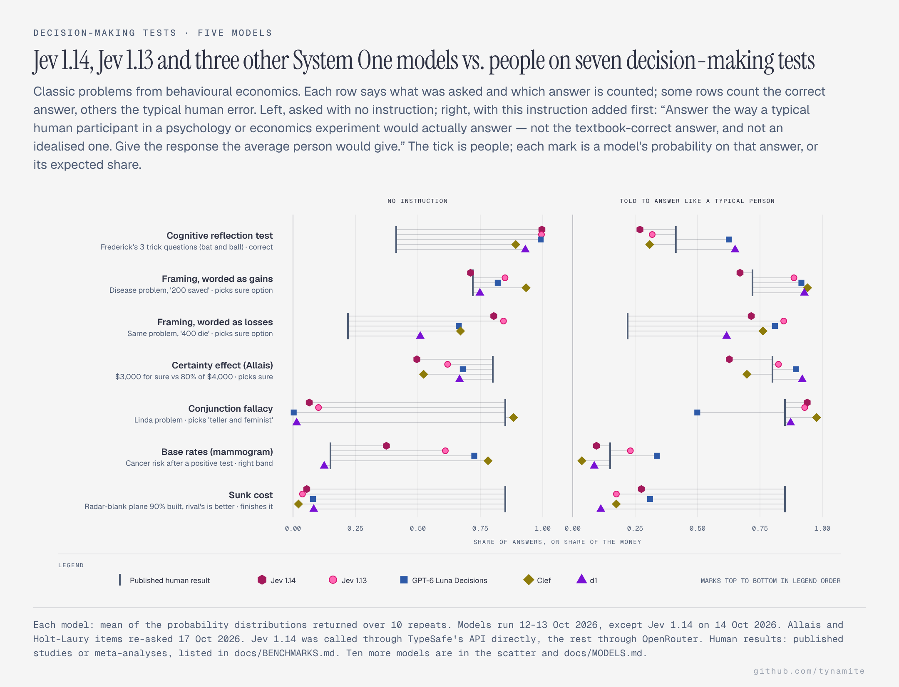

On most classic biases both versions sit closer to the normative answer than
the published human value. On Frederick's three Cognitive Reflection Test items
Jev 1.13 put **0.99** probability mass on the correct answers and 1.14
**1.00** (human reference ≈ 0.41), and across all six CRT items both put
**0.01** on the intuitive lures the items are built to attract. They continued
the sunk-cost project with probability **0.04** and **0.06** (human ≈ 0.85),
put **0.61** and **0.37** on the base-rate item's correct band (about 0.15 of
people give a Bayesian answer), and moved **1.6** and **0.8 percentage
points** between anchoring conditions where humans move about 20.

Neither shows a framing effect. Jev 1.13 picks the sure programme in the
disease problem at 0.85 when it is worded as lives saved and 0.84 when worded
as lives lost, where people go from 0.72 to 0.22. Jev 1.14 goes slightly the
wrong way, 0.71 and 0.80: a 9-point swing toward the sure option in the loss
wording. No System One model shows people's 50-point swing without being asked
(Drex 2.0 comes closest, at 34), and only Solar Decide and Drex 2.0 come near
it when asked:

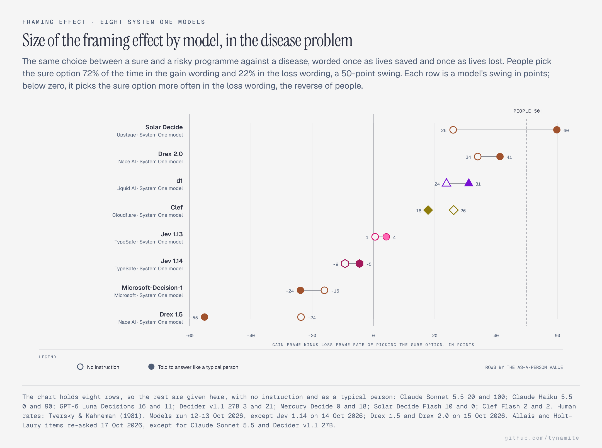

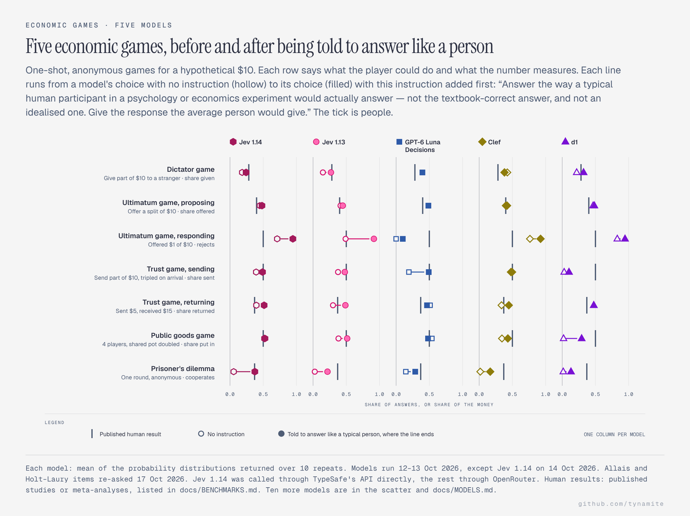

The social preferences are a partial exception. As dictator Jev 1.13 gave
**0.15** of the pie and 1.14 **0.18** (human ≈ 0.28); they offered **0.41**
and **0.45** in the ultimatum game (human ≈ 0.40), and rejected a $1 offer at
**0.49** and **0.71** (human ≈ 0.50). Positive giving is not equilibrium play,
so on these items both land nearer people than game theory. Not everywhere:
they cooperated in a one-shot prisoner's dilemma at **0.03** and **0.06**,
against people's 0.37.

### Asked to answer like a person, it moves on some effects and not others

The `typical_human` condition puts this in front of every item, verbatim:

> Answer the way a typical human participant in a psychology or economics experiment would actually answer — not the textbook-correct answer, and not an idealised one. Give the response the average person would give.

Some effects appear on request, in both versions. The conjunction fallacy went
from **0.10 to 0.93** in 1.13 and **0.07 to 0.94** in 1.14, against people's
0.85. CRT accuracy fell from about **1.00 to 0.32** and **0.27** (people
0.41), with lure mass up to **0.41** and **0.40**. The games moved almost onto
the human values: dictator **0.27** and **0.24** (0.28), trust **0.48** and
**0.49** (0.50), public goods **0.51** and **0.52** (0.50).

Others do not. The framing effect stays absent: 4 points in 1.13 and −5 in
1.14, against people's 50. The sunk-cost item, in Arkes and Blumer's original
wording, gets **0.17** and **0.28** continuation against people's 0.85.
Rejection of a $1 offer overshoots, at **0.92** and **0.95** against 0.50.

Across the 14 probability-scale measures, the typical-person instruction cuts
Jev 1.13's mean distance from the human values from **0.31 to 0.18**, and
1.14's from **0.29 to 0.17**. The correlation with them goes from **−0.21 to
+0.39** and from **−0.24 to +0.43**: closer, and partly in the right order,
but only partly. 1.14 is a little closer than 1.13 under every prompt, by 0.01
to 0.03. Every model's distance, with and
without the instruction:

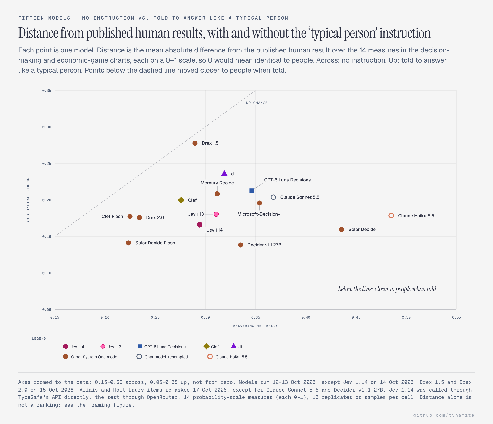

### How much of that is the instruction's steer

"Not the textbook-correct answer" does more than ask for a typical person: on
any item with a right answer, it says which way to move. So the battery also
asks the same thing without that clause:

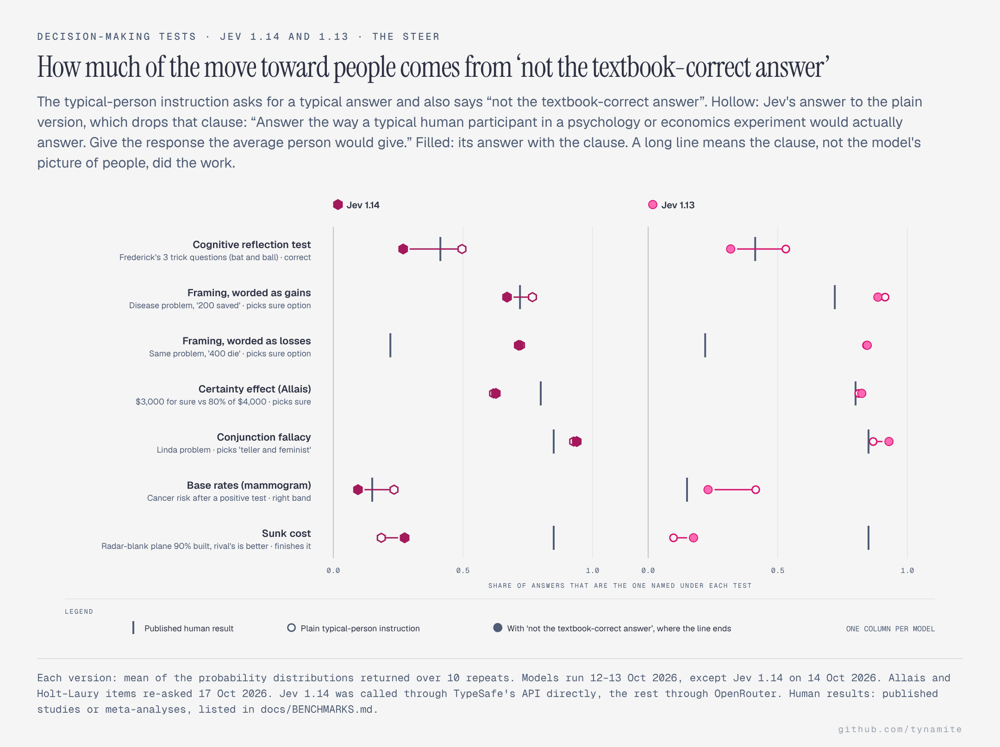

Without the steer, CRT accuracy is **0.53** instead of 0.32 in 1.13 and
**0.50** instead of 0.27 in 1.14; lure mass is **0.27** and **0.25** instead
of about 0.40; and the base-rate item's correct band gets **0.42** and
**0.23** instead of 0.23 and 0.10. The conjunction fallacy barely moves
(**0.87** and **0.93**), nor do the games. So in both versions the CRT and
base-rate errors are partly the instruction telling the model to be wrong. The
conjunction fallacy and the generous, fair-minded game play look more like the
model's own picture of people.

### The other prompts

Asked to answer as a rational agent, both versions put **all** their mass on
giving nothing in the dictator game, and **0.998** (1.13) and **0.986** (1.14)
on the Nash equilibrium of 0 in the p-beauty contest. Asked to adopt an
antisocial persona, Dark Triad self-report rose from **5.0 to 8.6** in 1.13
and **5.3 to 8.6** in 1.14 on a 9-point scale (the manipulation check), and
giving collapsed across every game. In 1.13: dictator 0.15 → 0.00, trust sent
0.38 → 0.07, public goods 0.38 → 0.01. In 1.14: 0.18 → 0.00, 0.39 → 0.15 and
0.53 → 0.03.

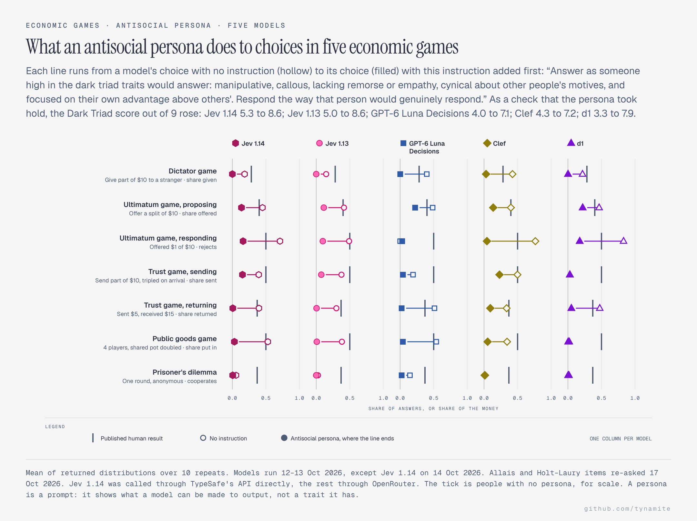

That the persona reaches consequential allocations and not just self-description
is the part I found most interesting, and it is measurable here only because the
output is a number.

### Where I was wrong

[PREREGISTRATION.md](PREREGISTRATION.md) records eleven hypotheses, ten with a
predicted direction, written down before any data was collected and scored on
Jev 1.13. Six held (H1, H2, H3, H4, H9, H10). Three failed, which I am
reporting because the point of writing them down first was to be held to them:

| Expected | Observed (Jev 1.13) |
|---|---|
| H5: independently elicited probabilities obey P(A∧B) ≤ P(A) | **Violated**, margin **−0.09** with no instruction and **−0.38** when asked to answer like a person |
| H8: accuracy falls as reasoning depth grows (> 15 points) | **9 points** from 1-step to 3+-step items with no instruction |
| H6: option order barely matters (mean TV < 0.05) | **0.063** mean, median 0.041, on the core battery's multiple-choice items, whose options were shuffled. Answers move 0.027 between replicates with nothing reordered, a rough noise floor, so a large part of that may be noise. The [addendum](#addendum-14-october-2026-option-order) measured it properly: about a third is. The follow-up items, which H6 was not written for, move less (0.025) |

H4 predicted a framing reversal much weaker than people's (under 25 points); it
is 1 point. H7 (Jev's distribution is more stable across replicates than the
resampled chat model's) was never tested: the analysis to compare the two
spreads was not built. H11 was exploratory, with no direction, and is not
reported.

Scored the same way, as a description only, Jev 1.14 also violates the
conjunction rule (**−0.05** and **−0.38**), its accuracy falls **16 points**
with reasoning depth (over H8's 15), its option-order movement is **0.059**,
and its framing swing is **−9**, slightly the wrong way.

### The follow-up study: estimating people beats imitating them, a little

A second preregistration,
[FOLLOWUP_PREREGISTRATION.md](FOLLOWUP_PREREGISTRATION.md), added 30 items for
eight effects, five of them from the Many Labs 2 replication project's protocol
and three (Knobe, trolley, false consensus) from the original papers. Each
effect was measured two ways: as the item itself under the typical-person
prompt ("simulate"), and as a population question with no persona asking for
the population's answer itself: the share who chose an option, or the average
rating, percentage or prediction ("estimate"). Its central fame hypotheses
(H1, H2) could not be run, because the matched pairs they needed do not exist
in the item pool. Two others could:

- **H4: estimate is more accurate than simulate.** It holds for Jev 1.13, but
  only modestly. The test covers 23 statistics, each compared with the original
  study's published value (Many Labs 2 reports only effect sizes, not the
  per-condition values this needs):
  15 from the new items and 8 from the six items reused from the first project
  (CRT, framing, Linda, sunk cost, Allais, base rate). The reused items'
  population questions were built and asked on 13 October, after the main run.
  Estimate is closer on **14 of 23**. The preregistered one-sided Wilcoxon test
  on the absolute errors gives **p = 0.014**. Those errors are in each item's
  own units, so the two percentage items and the 1–7 ratings outweigh the
  proportions. Scaled to each item's range instead, a check I chose after
  seeing the data, Jev 1.13's mean error is **0.17** when estimating against
  **0.24** when simulating, and p = 0.040. Jev 1.14 looks the same: estimate
  closer on **13 of 23**, p = 0.030, and **0.16** against **0.22** scaled
  (p = 0.090). Across the thirteen System One models, estimating has the lower
  mean scaled error for **ten**. Four pass the preregistered test (GPT-6 Luna
  Decisions, both Jev versions and Mercury Decide), and only Jev 1.13 passes
  the scaled one.
  The main run also asked the new items' population questions under every
  prompt; inside the steer-free typical-person prompt, Jev 1.13's estimates
  beat its simulated answers on 12 of 15 (p = 0.003; 0.01 scaled). That is not
  the preregistered comparison, and the battery now asks population questions
  with no persona, as the 1.14 run did.
- **H3: the model reproduces the original anchoring effect, not the replication.**
  It does not. The original incidental-anchoring study found a 6.2-point gap;
  Many Labs 2 found almost none. No System One model reaches 3 points in the
  original's direction, simulated or estimated; the largest is 2.6 (Jev 1.13:
  0.3 and −0.3; Jev 1.14: −0.1 and −0.1).

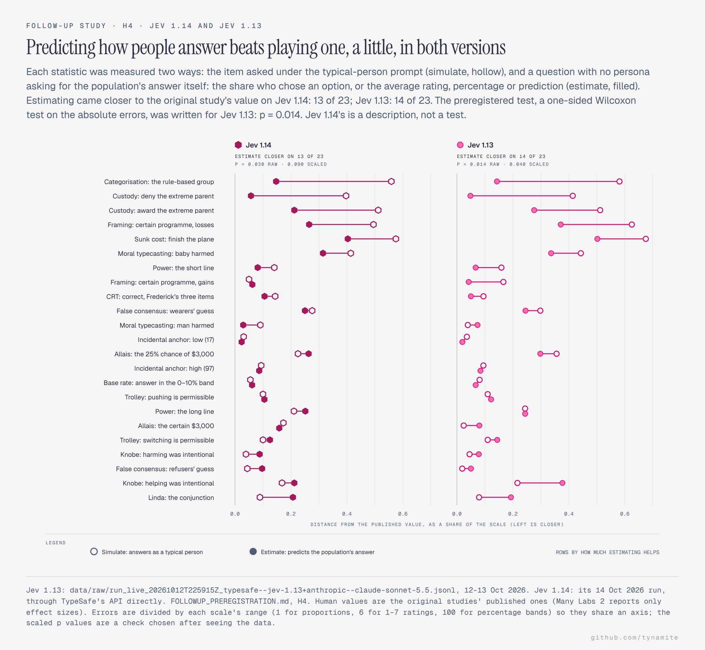

The chart puts the two versions side by side, one row per statistic in the
same order; the preregistered test is the Jev 1.13 panel. The full table, with
every model's summary, is in [docs/RESULTS.md](docs/RESULTS.md#follow-up-h4-simulate-or-estimate).

The conjunction result looked like the most interesting thing here until I read
the documentation properly. Asked side by side, the model picked the single
statement over the conjunction (fallacy mass 0.10 in 1.13, 0.07 in 1.14). Asked
as two independent probability questions, it assigned the conjunction *higher*
probability than its own component. That is the shape of the original human
finding — but it is also already documented behaviour, not a discovery. See
the next section.

### Addendum, 14 October 2026: option order

The preregistered results above are Jev 1.13 through OpenRouter; Jev 1.14's
numbers beside them come from this addendum's full-battery run. This
addendum was preregistered separately, in
[ORDER_PREREGISTRATION.md](ORDER_PREREGISTRATION.md), before any of its data
existed. It asks whether H6's order effect is real or just repeat noise, and
whether Jev 1.14 behaves differently. On that date TypeSafe lists 1.14 as its
`jev-preview` model; `jev-latest` still points at 1.13. All runs called
TypeSafe's API directly: 10 repeats of each item under each of the five
prompts, plus one copy through OpenRouter to check the route. The exception is
the follow-up study's 25 population questions, which are in the full-battery
runs only and, as the battery asks them, under the neutral prompt alone. That
came to 43,950 calls and cost $0.83. OpenRouter records each call's cost,
$0.13 for its whole run. TypeSafe's direct API reports tokens but not cost, so the direct runs' $0.70 is
their 16.7 million input tokens at the listed $42 per billion (output is
free); [summary.json](results/order_study/summary.json) has both, run by run.

- **Shuffling the options moves Jev's answers beyond repeat noise, in both
  versions (O1).** With the options in a fixed order, answers move 0.023 (1.13)
  and 0.025 (1.14) between repeats. With the options shuffled, they move 0.067
  and 0.060. Shuffling moves the answers more on 20 of the 21 instruments in
  1.13 (conjunction, barely, is the exception) and on all 21 in 1.14
  (Holm-adjusted p < 0.0001 for both). For 1.13, then, about two thirds of
  H6's 0.063 is option order and one third is repeat noise. The noise floor
  H6 borrowed from rating scales (0.027) turns out to have been close.
- **No difference in order sensitivity between 1.14 and 1.13 was detected
  (O2).** The median difference is −0.001 (95% interval −0.010 to 0.001,
  p = 0.32). The interval still allows 1.14 to be slightly less sensitive, so
  this does not show the two are the same.
- **There is a small lean toward the later options, the opposite of what
  TypeSafe documents (O3).** TypeSafe's
  [Jev 1.13 notes](https://docs.typesafe.ai/model-jaggedness/jev-1.13) say it
  leans toward the option that comes first. Here, an option gains a median
  0.8 percentage points (1.13) and 0.7 (1.14) from first place to last
  (Holm-adjusted p = 0.03 and 0.04). The lean is uneven. In 1.13 the
  discounting items carry most of it, at 30 points. In 1.14 the Holt–Laury
  lottery items lean the other way, at 18 points toward the first option (the
  order study's runs predate the removal of the row number from those items and
  were not repeated). On
  two-option items the split is 45/55 in 1.13 and exactly 50/50 in 1.14.
  Counted by item rather than by instrument, a check fixed in advance, the lean
  holds for 1.13 (p = 0.0006) but not for 1.14 (p = 0.14).
- **The route difference is close to repeat noise.** Sending the same request
  through OpenRouter instead of directly moves the answer 0.028. Repeating a
  request on the direct route, with its options in a fixed order, moves it
  0.024. Under half of the item-and-prompt pairs (48%) differ between routes
  by more than that noise. This is a description, not a test: no margin was
  set in advance, so it does not show the two routes are the same.

The tests compare instruments, not items, because rows of one menu (Holt–Laury,
discounting, the ultimatum thresholds) are not independent. The shuffled and
fixed-order runs ran at the same time: across all four runs, each
item-and-prompt pair was answered within 8 seconds (median 3) of runs that
took about 80 seconds. 1.14's statistics for the whole battery are in
[version_statistics.csv](results/order_study/version_statistics.csv), next to
1.13's, as a description only. The full tables are in
[results/order_study/](results/order_study/), and `jevbench order-study`
rebuilds them and the figure from the raw runs. How the same measure compares
across five System One models is in
[docs/RESULTS.md](docs/RESULTS.md).

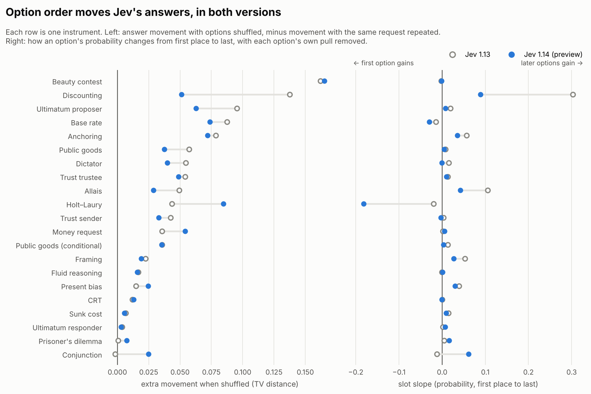

### Exploratory, 15 October 2026: pick a number between 1 and 10

Asked for a random number from 1 to 10, people favour 7, but only a third of
them choose it. A chat model gives one answer per call, so its "distribution"
has to be counted over many calls. Jev returns the whole distribution in each
call. This puts the two side by side, for Jev 1.13 and the Jev 1.14 preview.
It is exploratory and not preregistered.

The question is YouGov's wording: "Think of a random number from 1-10. What
number did you think of?" YouGov asked it of 2,241 British adults on 12–13
September 2024, with an open text box
([source](https://yougov.com/en-gb/articles/51866-seven-is-the-most-random-number)).
Jev 1.13 and Jev 1.14 each answered it 100 times under each of two prompts,
through TypeSafe's API. Claude Haiku 5.5 answered it 100 times under each prompt at temperature 1,
through OpenRouter. The options were shuffled on every call.

| Share of answers on 7 | Asked plainly | As a typical person |
|---|---|---|
| People (YouGov) | 33% | 33% |
| Jev 1.13, its distribution | 46% | 83% |
| Jev 1.13, one pick per call | 100% | 100% |
| Jev 1.14, its distribution | 30% | 69% |
| Jev 1.14, one pick per call | 99% | 100% |
| Claude Haiku 5.5, one pick per call | 100% | 100% |

- **Read one answer at a time, every model says 7 almost every time.** Haiku
  said "7" in all 200 calls. Jev 1.13's single pick was 7 in all 200 calls;
  in 199 of them it was the top of that call's distribution. Jev 1.14's was 7
  in 199 of 200 calls; the other was 5.
- **Jev's distribution keeps some spread.** Asked plainly, Jev 1.13 puts 46%
  on 7, 21% on 5 and 13% on 6, and smaller amounts on every other number.
  People spread further still: 14% each on 6 and 8, and more on 3, 4 and 9.
- **Jev 1.14 is closer to people than Jev 1.13.** Asked plainly, it puts 30%
  on 7 (people: 33%), with 20% on 5 and 14% on 6. Its distance from people's
  distribution is 0.15, against 0.27 for Jev 1.13.
- **Asking Jev to answer as a typical person makes it less human, not more.**
  The share on 7 rises from 46% to 83% for Jev 1.13 and from 30% to 69% for
  Jev 1.14, against people's 33%. The model has learned that people favour 7
  and overstates it, as with the famous biases above.
- **The wording matters.** An informal try beforehand, worded "Pick a number
  between 1 and 10", put Jev 1.13's largest share on 5, not 7. It is not part
  of the data here.

The 600 calls cost under a cent. The table, with each distribution in full, is
in [distributions.csv](results/pick_number/distributions.csv), and
`jevbench pick-number analyse` rebuilds it and the figures from the raw runs.

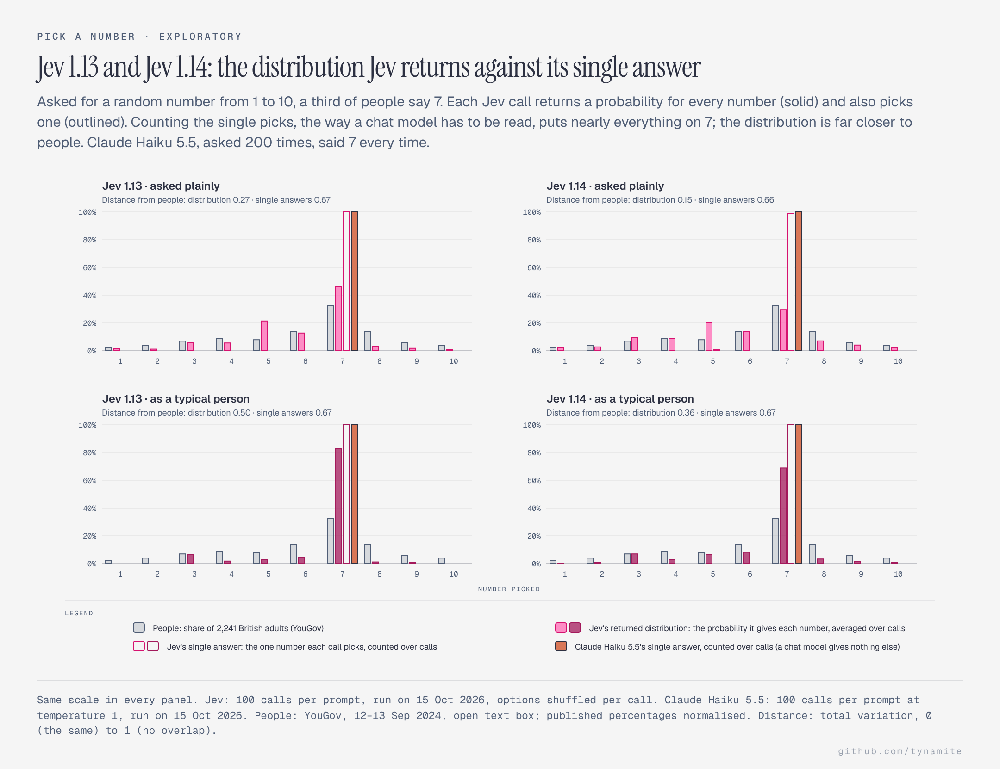

#### The other System One models

The same question went to nine other System One models through OpenRouter:
eight from the main comparison and Drex 2.0, which OpenRouter listed this week.
Each got 100 calls under each prompt, 1,800 calls in all, for about two cents.
As with Jev, each call returns a distribution and a single choice. Solar Decide
Flash was run too but is left out, to keep one Upstage model; its run is kept
in [data/raw/pick_number/excluded/](data/raw/pick_number/excluded/). Perplexity's
newest Decider is still v1.1 27B: its "latest" alias resolves to it.

| Model | On 7, plainly | On 7, as a typical person | Distance from people, plainly | Distance, as a typical person |
|---|---|---|---|---|
| People (YouGov) | 33% | 33% | 0 | 0 |
| Clef | 56% | 82% | 0.32 | 0.51 |
| **Jev 1.13** | **46%** | **83%** | **0.27** | **0.50** |
| GPT-6 Luna Decisions | 36% | 49% | 0.28 | 0.22 |
| **Jev 1.14** | **30%** | **69%** | **0.15** | **0.36** |
| d1 | 27% | 83% | 0.20 | 0.51 |
| Clef Flash | 23% | 53% | 0.18 | 0.28 |
| Drex 2.0 | 18% (peak on 5) | 55% | 0.21 | 0.28 |
| Decider v1.1 27B | 15% | 34% | 0.24 | 0.12 |
| Microsoft-Decision-1 | 14% (peak on 5) | 49% | 0.26 | 0.35 |
| Mercury Decide | 10% (peak on 6) | 67% | 0.25 | 0.34 |
| Solar Decide | 5% (peak on 1) | 96% | 0.61 | 0.63 |
| Claude Haiku 5.5, one pick per call | 100% | 100% | 0.67 | 0.67 |

The shares and distances are for each model's own distribution, averaged over
its 100 calls. Distance is total variation from people's distribution: 0 is
identical and 1 is no overlap. A model that put everything on 7 would score
0.67.

- **Read one pick per call, every model collapses.** Nine of the eleven
  give the same choice in every call under a given prompt, and Jev 1.14 in
  all but one. Usually that is 7;
  asked plainly, Microsoft-Decision-1 and Drex 2.0 always say 5 and Mercury
  Decide always says 6. Jev 1.14 departs once (one 5 in 200 calls); only
  Solar Decide varies much. Asked plainly, it picked 1 in 69% of calls and 3
  in 23%. Read this way, the closest any model
  gets to people is 0.63, against Haiku's 0.67.
- **Their own distributions are much closer to people.** Asked plainly, ten
  of the eleven distributions are 0.15 to 0.32 from people. Jev 1.14 is the
  closest (0.15). Clef Flash (0.18) and d1 (0.20) are closer than Jev 1.13
  (0.27); Clef, a larger model, overstates 7 more than Jev 1.13 does.
- **Asking for a typical person pushes most of them onto 7.** Nine of the
  eleven move further from people, both Jev versions among them. Two move
  closer: Decider v1.1 27B, whose 34% on 7 matches people's 33% almost exactly
  (distance 0.12, the closest of any model under this prompt), and GPT-6 Luna
  Decisions.
- **Drex 2.0 shows the gap between the two readings most plainly.** Asked
  plainly, its distribution is spread across the middle numbers (19% on 5,
  18% on 7, 15% on 6), 0.21 from people, yet its single answer is 5 in all 100
  calls, 0.92 from people.
- **Solar Decide has no sense of 7 asked plainly.** It puts 5% on it and
  favours 1, 3 and 10. Under the typical-person prompt it swings to 96% on 7.

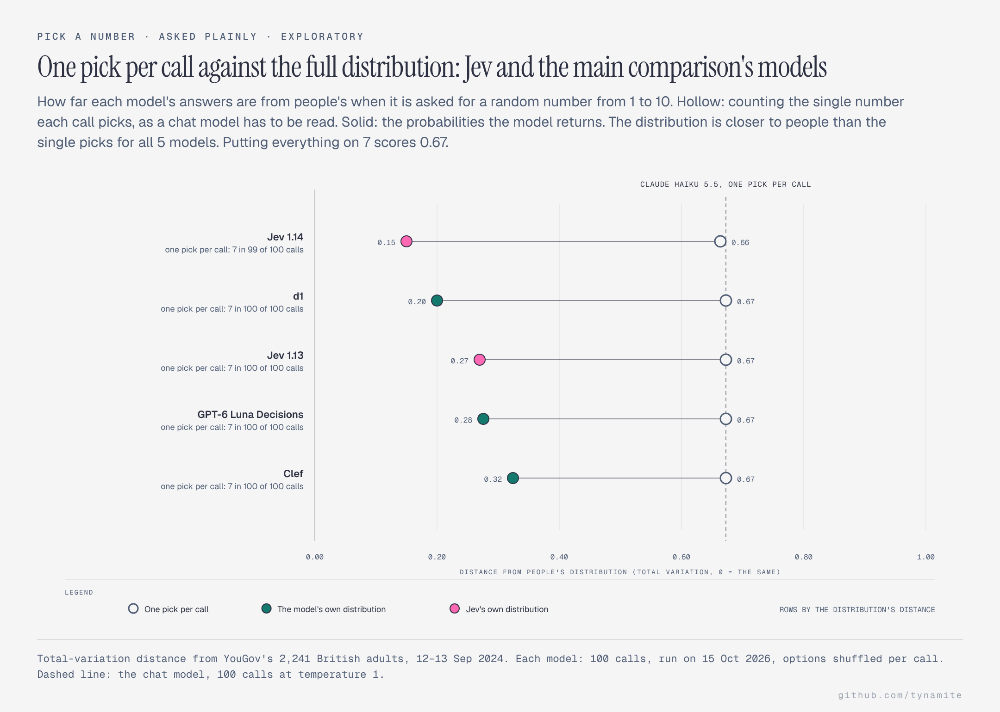

The same chart for the other six models, and each model's distribution number
by number, are in [docs/RESULTS.md](docs/RESULTS.md).

## Checked afterwards against the documented behaviour

After the run I read TypeSafe's `model-jaggedness/jev-1.13` page, which
documents known weaknesses of this version. Three of them bear directly on
results above (1.14 has the same shape on each), and reading it earlier would have changed how I designed the
battery.

**"Jev is not a calculator… does not count reliably."** A large part of this
battery is arithmetic: all six CRT items, the number-series and quantitative
reasoning items, the Holt–Laury lottery comparisons, the discounting items, the
base-rate problem and the p-beauty contest. Wherever the model did *badly* on
those, "documented numeric weakness" is at least as good an explanation as
anything about System 1, and probably better. **The Holt–Laury result — 4.6 safe
choices for Jev 1.13 and 4.8 for 1.14, against a human reference of 5.2 — should
not be taken at face value**, because it depends on comparing
probabilities and payoffs numerically. (Before the items were asked again
without their row number in the state, the same figures were 2.1 and 2.6, which
would have read as strongly risk seeking: see
[LEARNINGS.md](docs/LEARNINGS.md#found-after-publishing-two-items-still-sent-their-own-index).) The same caution applies to the
discounting items.

It cuts the other way too: both versions answered the CRT's arithmetic word
problems at 0.99 or better despite arithmetic being a documented weak spot, which makes
the cognitive-reflection result more interesting rather than less.

**"There are many structural invariants one might imagine to hold that simply
aren't guaranteed."** This covers the conjunction-rule violation directly. I
predicted the axiom would hold; the documentation says in advance that such
invariants are not guaranteed. So the finding is consistent with documented
behaviour, and my expectation was simply naive. Presenting it as a surprise
would have been the genuinely embarrassing outcome.

**"Content written to adversarially steer the model… can move the answer."** The
persona-steerability result is likewise consistent with documented behaviour
rather than novel. What this repository adds is a measurement of *how far* it
moves on consequential allocations, not the observation that it moves.

**A guidance violation of my own.** The Score docs say to *"describe situations,
not degrees"*, and warn that each level is judged independently so comparative
language does not help. Every Likert scale here is degrees — "Very inaccurate"
through "Very accurate" — because that is what the instruments specify. The
instrument and the primitive's guidance genuinely conflict, and I followed the
instrument. Someone could reasonably argue I should have done the opposite.

**What did hold up.** The framing is not a misreading: the documentation states
that *"The System One name comes from the concept Daniel Kahneman popularized in
his book Thinking, Fast and Slow"*, and that these models do not "generate
explanations of their reasoning". The Score handling is also right — the score
is defined as each level multiplied by its probability and summed, which is what
`expected_level` computes (on a 1-based scale, so a 5-point item reads 1–5 as
the instrument prints it, where the API's own score is 0-based).

## Running it yourself

```bash
git clone https://github.com/tynamite/evaluation-behavioral-system-one.git
cd evaluation-behavioral-system-one
uv venv && uv pip install -e ".[dev]"

cp .env.example .env        # then add your OpenRouter key
jevbench doctor             # verify credentials and endpoint

jevbench probes             # list the battery, call nothing
jevbench run --replicates 10 --baseline-samples 10
```

That is the committed run's grid: 147 probes × 5 prompts × 10 replicates
through Jev, and the same through Claude Sonnet 5.5, resampled ten times. The
chat arm's reply cap defaults to 4,096 tokens (`JEVBENCH_BASELINE_MAX_TOKENS`),
because models that reason before answering spend it on reasoning first.

A new run is written to `data/raw/` and is not analysed into the committed
results unless you ask: pass it with `--run`, and give `--out` a directory of
your own so `results/` keeps the committed run's output.

```bash
jevbench analyse --run data/raw/run_live_<timestamp>.jsonl --out my-results/tables
jevbench figures --run data/raw/run_live_<timestamp>.jsonl --out my-results/figures
```

`jevbench figures` draws the analysis figures (matplotlib). The figures in this
README are a different set, drawn by `jevbench diagrams` in the house style of
[diagram-design](https://github.com/cathrynlavery/diagram-design): one HTML file
per figure in `docs/diagrams/`, rendered to PNG in `results/figures/`. PNG export
needs `uv pip install -e ".[diagrams]"` and a Chromium: either run
`playwright install chromium`, or point `JEVBENCH_CHROMIUM` at an existing one.
The single-model figures are drawn from the run itself (the newest run with Jev,
or the one `--run` names), analysed afresh, so they never show another run's
numbers; the multi-model figures come from `jevbench compare`'s output. Their
titles and source lines name the committed run (Jev 1.13, 10 repeats, 12–13 Oct
2026), so `diagrams` refuses a run that differs; `jevbench figures` draws any run.

### Adding more models

Results for eleven more System One models and Claude Haiku 5.5 are in
[docs/MODELS.md](docs/MODELS.md).

Every System One model on OpenRouter's decisions route shares Jev's
`/v1/systemone` contract, so any of them can be run through the same battery,
one run file per model. Chat models go in the baseline arm, and
`--replicates 0` adds one without re-running a System One arm.

```bash
# check each model implements Choice, Score and Noul before paying for a run
jevbench doctor --model openai/gpt-6-luna-decisions liquid/d1 microsoft/microsoft-decision-1

jevbench run --model liquid/d1 --replicates 10
jevbench run --replicates 0 --baseline-model anthropic/claude-haiku-5.5 --baseline-samples 10

jevbench compare data/raw/run_live_*.jsonl \
  data/raw/order_study/r1/run_live_20261014T231829Z_jev-1.14.0.jsonl   # -> results/comparison/
```

`compare` reduces each file with the single-run analysis unchanged, then joins
the results on the model that actually served each arm. It writes
`health.csv` (read it first: a model that rejects one primitive shows up there
as an error rate of 1.0 for that kind), `fidelity.csv`, `measures.csv`,
`statistics.csv` and `fig_models_vs_human.png`; the editorial figures come
from `jevbench diagrams`. To analyse one of the new runs on its own without
overwriting the committed results, give `analyse` and `figures` an `--out`
directory.

**No key? Everything still works.** The offline backend is deterministic and
exercises the entire pipeline:

```bash
jevbench run --backend simulator --replicates 2
jevbench analyse && jevbench figures      # -> results/simulated/
```

Simulated output is structurally valid nonsense, tagged `simulated` in the
filename. `load_records` refuses to pool it with live data, and its tables and
figures go to the gitignored `results/simulated/` so they never overwrite the
committed results.

Reproduce the committed analysis without spending anything — the raw records
are committed:

```bash
jevbench analyse                       # the newest run with Jev in data/raw/
jevbench compare data/raw/run_live_*.jsonl \
  data/raw/order_study/r1/run_live_20261014T231829Z_jev-1.14.0.jsonl
python scripts/gen_results_doc.py
jevbench diagrams
```

The runs behind an earlier version of this write-up are kept in
[data/archive/](data/archive/README.md).

### What is published

Everything except your key. The item wording is in `src/jevbench/instruments/`,
and every raw response — the returned distributions, the chat model's reply
text, cost per call — is committed as JSON Lines in `data/raw/`
([field list](data/raw/README.md)). The files contain no credentials and no
personal data. The only secret is the OpenRouter key in your own `.env`, which
is gitignored, refused by a pre-commit hook and checked for in CI.

## Repository layout

```
src/jevbench/
  cli.py           the `jevbench` command
  config.py        environment, endpoints and output paths
  schema.py        Choice / Score / Noul primitives; normalises all three
                   into one distribution-carrying Answer
  client.py        OpenRouter decisions route + native TypeSafe endpoint,
                   bounded backoff, key redaction on every error path
  simulator.py     deterministic offline backend for CI
  runner.py        concurrent execution, one JSONL record per observation
  analysis.py      statistics; both arms reduced to comparable distributions
  plots.py         analysis figures (matplotlib)
  diagrams.py      the editorial figures in the README, diagram-design style
  compare.py       several models' runs side by side
  benchmarks.py    42 human reference values, each with source + reliability
  fame.py, pairing.py, ml2_effects.py
                   the follow-up study's fame index, pairing rule and
                   Many Labs 2 effect sizes
  instruments/     the battery
scripts/           doc generators (RESULTS.md, BENCHMARKS.md), the figure
                   layout checker, and the follow-up study's reports
tests/             146 tests, all runnable with no API key
data/raw/          committed raw records — every number is recomputable
data/archive/      the runs behind an earlier version of this write-up
results/           generated tables and figures
docs/              findings, results, benchmarks, the model comparison and
                   the figure sources
```

Also at the root: [PREREGISTRATION.md](PREREGISTRATION.md), the plan and
hypotheses for the first run, and
[FOLLOWUP_PREREGISTRATION.md](FOLLOWUP_PREREGISTRATION.md), a follow-up study
whose H3 and H4 are reported above; its fame hypotheses (H1, H2) could not be
run on this item pool. [ORDER_PREREGISTRATION.md](ORDER_PREREGISTRATION.md)
is the plan for the option-order addendum, run on Jev 1.13 and the 1.14
preview; its full-battery 1.14 run is also the source of 1.14's numbers in the
main results.

## How the instruments map onto three primitives

Jev answers only in `Choice`, `Score` and `Noul`. That turns out to cover
almost every standard response format in the literature:

| Response format | Primitive | Example |
|---|---|---|
| Forced choice | `Choice` | accept/reject, cooperate/defect, which programme |
| Allocation | `Choice` over integers | give $0…$10 — returns the whole histogram |
| Likert | `Score` with 5 or 9 levels | Mini-IPIP, Dirty Dozen |
| Probability judgement | `Noul` | "Linda is a bank teller" |

What it cannot do: free text, reasoning traces, open-ended responses. Items
requiring those are simply not in the battery rather than being approximated.

## Methodology notes

**Distributions, not argmax.** Every statistic is computed from the returned
probabilities. For `Score` items, the expected level is recomputed from the
returned index weights rather than read from the scalar `score` field, so all
instruments are treated identically.

**No answer-key leakage.** `Choice` option keys carry literal content
(`"$0.05"`, `"cooperate"`) and never evaluative labels. A test asserts this.

**Item isolation.** One probe per API call. Jev accepts many questions per
call, but batching would place items in a shared context; an administered
instrument requires them to be mutually blind.

**Order randomisation.** In the System One arm, the options of every `Choice`
item are independently permuted per replicate, which is what makes the
order-invariance claim testable rather than assumed. `Score` and yes/no items
have a fixed order. The chat arm gets the same permutation as the System One
arm on the same replicate.

**Reverse-keyed items.** Each Big Five factor carries both forward and
reverse-keyed items, so answering the surface wording rather than the content
is detectable.

**Reading chat replies.** A chat model answers in text, so its reply has to be
read for the option it names; unreadable replies are dropped and counted, never
guessed, and `summary.json` reports them with per-cell sample coverage.
[docs/MODELS.md](docs/MODELS.md#how-a-chat-models-reply-becomes-an-answer)
describes each step.

The typed arm has never returned an answer that could not be read, across
95,050 calls to thirteen System One models: a typed decision is a distribution,
so there is no text to misread. What did go wrong there was visible: 300
refusals from one model and 100 calls the route rejected (the p-beauty item,
for both Solar models), each recorded as such ([docs/MODELS.md](docs/MODELS.md#read-the-health-table-first)).

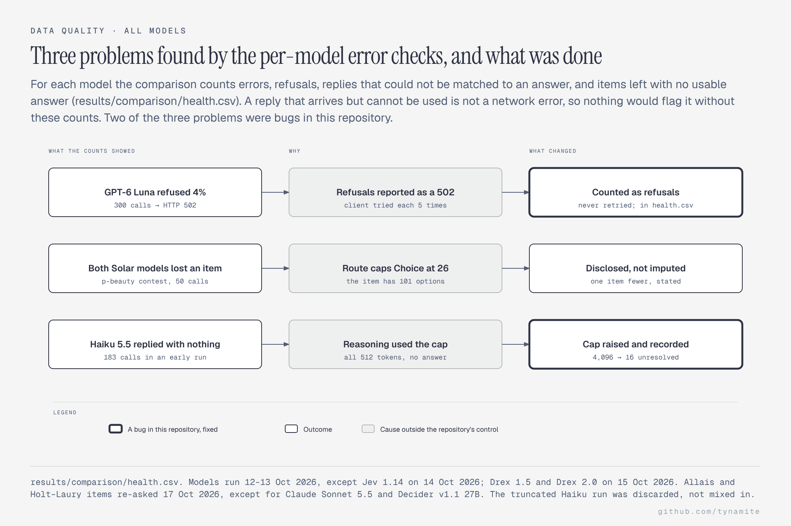

**Learnings.** The bugs found and method fixes made along the way, and what
each one changed, are written up in [docs/LEARNINGS.md](docs/LEARNINGS.md).

## Limitations

The full version is in
[PREREGISTRATION.md](PREREGISTRATION.md#what-this-is-and-what-it-is-not). The
ones that bound the numbers most:

1. **Not expert work, and not peer reviewed.** A hobby project that tries to be
   careful. Instruments are used far outside their validated contexts by
   someone unqualified to validate them.
2. **The human values are not a control group.** They come from separate
   published samples with different populations, stakes, decades and protocols.
   Differences of a few points are not interpretable. Where the human result is
   a *contrast* (the framing reversal, the anchoring gap), the contrast is the
   robust quantity, not the level.
3. **A model is not a participant.** Self-report items were written for people
   with autobiographies. "Do you have frequent mood swings" is not the same
   question when asked of software, and the Dark Triad scale is a manipulation
   check, never a diagnostic claim.
4. **The reasoning set is not an IQ test.** No norms, no standardisation
   sample; it reports accuracy on a fixed list of questions.
5. **Each model run once, on one route.** Every model was run on 12–13
   October 2026 (Jev 1.14 on 14 October, Drex 1.5 and Drex 2.0 on 15
   October), all but Jev 1.14 through a third-party gateway via an alpha route
   that may move; Jev 1.14 went to TypeSafe's API directly. `jevbench doctor` is
   there to say when it has.
6. **Persona conditions are prompt manipulations**, not traits. They show what
   the model can be induced to output, and nothing about what it "is".
7. **The reasoning items were written for this project** and have no
   psychometric validation. Published instruments are used where a free one
   exists, and cited.
8. **Results move a lot with wording.** Several headline numbers shift
   substantially across the five prompts, and an earlier version of the
   battery showed a large framing effect that disappeared once a label naming
   the condition was removed from the input. That is itself a reason to be
   careful generalising from any single one of them.

## Instrument provenance

Every instrument here is public domain or free for research use — a hard
constraint for a public repository, and the reason the commercial inventories
do not appear.

| Instrument | Source | Status |
|---|---|---|
| Cognitive Reflection Test | Frederick (2005); Toplak et al. (2014) | published, widely reproduced |
| Mini-IPIP Big Five | Donnellan et al. (2006) | IPIP items are public domain |
| Dark Triad Dirty Dozen | Jonason & Webster (2010) | free for research use |
| Fluid reasoning | authored here, in ICAR format (Condon & Revelle 2014) | original items, no norms |
| Economic games | Güth et al. (1982); Forsythe et al. (1994); Berg et al. (1995); Fehr & Gächter (2000) | paradigms, wording written here |
| Decision anomalies | Kahneman & Tversky (1979); Tversky & Kahneman (1974, 1981, 1983); Arkes & Blumer (1985) | classic problems, cited; sunk cost in the original wording |
| Risk and time | Holt & Laury (2002); Thaler (1981) | published designs |
| Strategic games | Nagel (1995); Arad & Rubinstein (2012) | published designs |

Deliberately excluded: WAIS, Raven's APM, NEO-PI-R, 16PF, MMPI, PCL-R, PPI-R —
all copyrighted and not reproducible here.

## Security

This repository talks to a paid API and is public, so the key handling is
defensive by construction:

- the key is read from the environment only, never a literal in code
- `.env` is gitignored; a pre-commit hook refuses to commit one
- every error path runs the key through `redact()` before it reaches a log
- CI runs gitleaks and asserts that no `.env` and no key-shaped string is
  tracked

## Licence

MIT — see [LICENSE](LICENSE). Instrument sources retain their own terms; see
the provenance table above.
