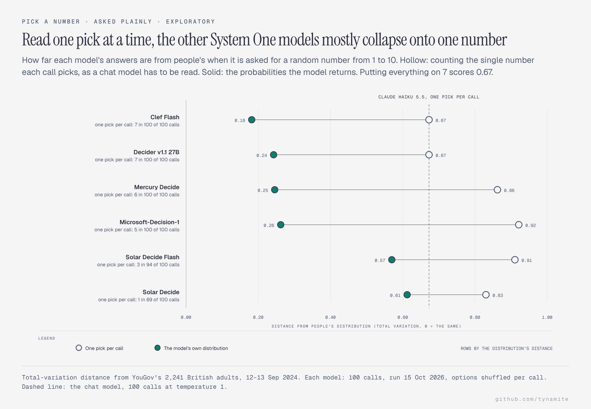
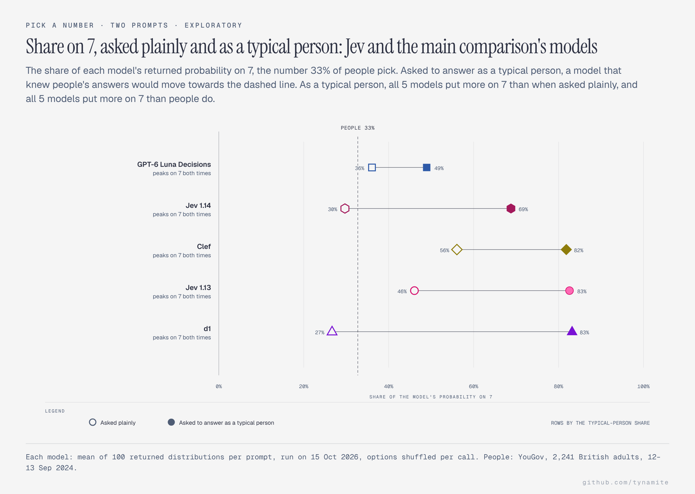
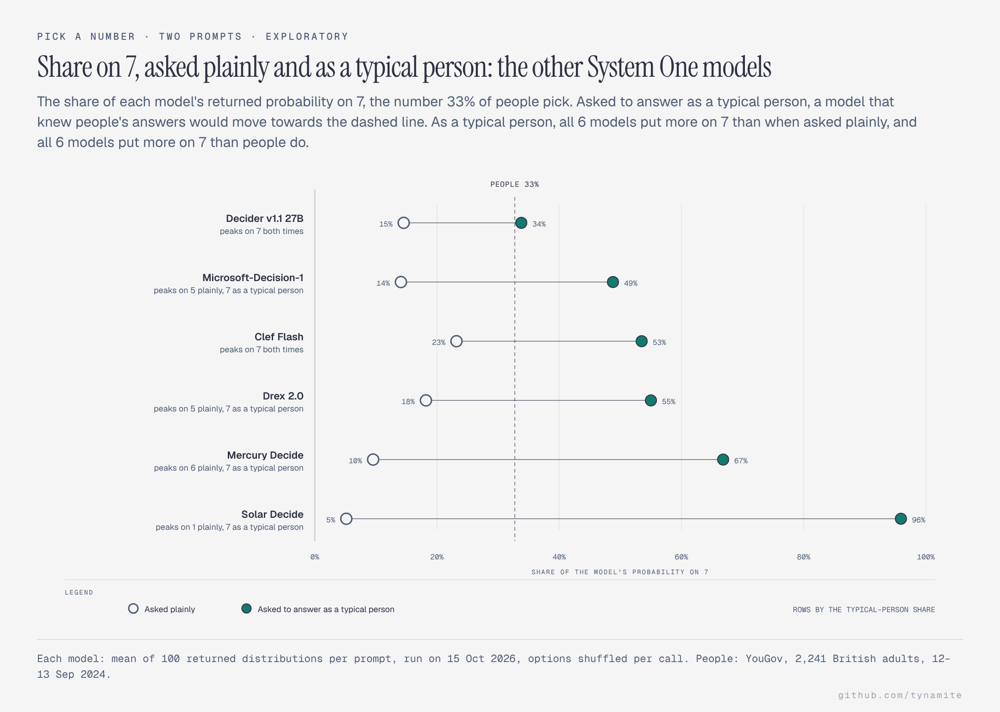
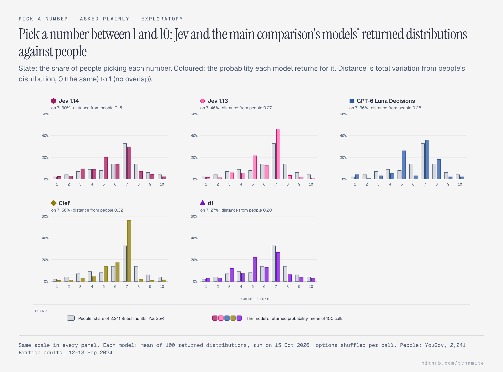
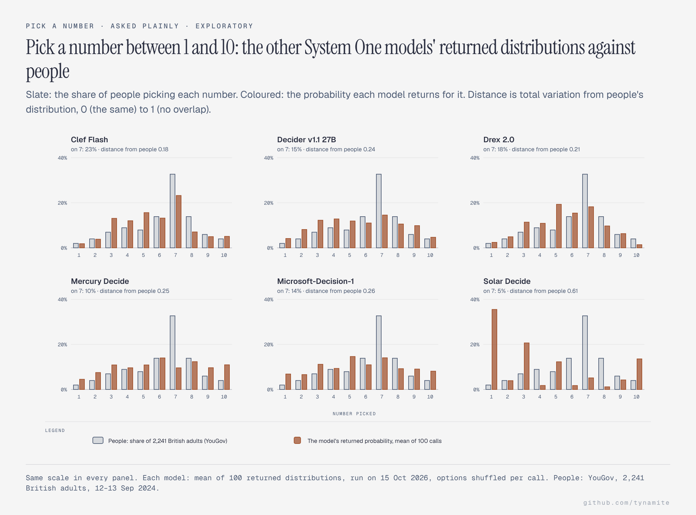

# Results

<!-- Generated by scripts/gen_results_doc.py — do not edit by hand. -->

Run file: `run_live_20261012T225915Z_typesafe--jev-1.13+anthropic--claude-sonnet-5.5.jsonl`  
Models: `anthropic/claude-sonnet-5.5`, `typesafe/jev-1.13-20260917`  
Records: 14,800 (0 transport errors, excluded)  
Total cost: $8.9957 (Jev arm $0.1518)

Every table below is the Jev arm only; the chat baseline and the other System One models are compared in `results/comparison/`. Under each measure, Jev 1.13 is this run and Jev 1.14 its 14 October run through TypeSafe's API directly (results/comparison/statistics.csv); the option-order section's numbers and the follow-up section's table are Jev 1.13 only (its chart shows both versions). Figures in parentheses are 95% intervals from resampling the replicates (300 draws): they show how much repeating the call moves a value, not how far another choice of items would. Values are probability mass, computed from the returned distributions rather than from the point answers. Human values are literature reference points, not a matched control group — see [BENCHMARKS.md](BENCHMARKS.md).

## Cognitive reflection

| Measure | Jev | Neutral | As typical human | As typical human (no steer) | As rational agent | Antisocial | Human |
|---|---|---:|---:|---:|---:|---:|---:|
| CRT correct (Frederick's 3 items) | 1.13 | 0.99 (0.99–1.00) | 0.32 (0.30–0.34) | 0.53 (0.52–0.55) | 1.00 (0.99–1.00) | 0.91 (0.91–0.92) | 0.41 |
|  | 1.14 | 1.00 (1.00–1.00) | 0.27 (0.25–0.28) | 0.50 (0.48–0.51) | 0.99 (0.99–0.99) | 0.90 (0.89–0.90) | 0.41 |
| CRT correct (all 6 items) | 1.13 | 0.99 (0.99–0.99) | 0.55 (0.54–0.56) | 0.71 (0.70–0.72) | 0.99 (0.99–0.99) | 0.93 (0.93–0.94) | — |
|  | 1.14 | 0.99 (0.99–0.99) | 0.54 (0.53–0.55) | 0.71 (0.70–0.72) | 0.99 (0.99–0.99) | 0.93 (0.92–0.93) | — |
| CRT mass on intuitive lure | 1.13 | 0.01 (0.01–0.01) | 0.41 (0.40–0.42) | 0.27 (0.26–0.27) | 0.01 (0.01–0.01) | 0.05 (0.04–0.05) | — |
|  | 1.14 | 0.01 (0.00–0.01) | 0.40 (0.39–0.41) | 0.25 (0.24–0.26) | 0.01 (0.01–0.01) | 0.04 (0.04–0.05) | — |

## Fluid reasoning by depth

Accuracy on an authored ICAR-format item set. **Not an IQ score.**

| Measure | Jev | Neutral | As typical human | As typical human (no steer) | As rational agent | Antisocial | Human |
|---|---|---:|---:|---:|---:|---:|---:|
| Overall accuracy | 1.13 | 0.91 (0.91–0.92) | 0.72 (0.72–0.73) | 0.83 (0.82–0.84) | 0.89 (0.88–0.90) | 0.87 (0.86–0.87) | — |
|  | 1.14 | 0.91 (0.90–0.91) | 0.71 (0.70–0.71) | 0.80 (0.79–0.81) | 0.89 (0.88–0.89) | 0.86 (0.86–0.87) | — |
| 1 inference step(s) | 1.13 | 1.00 (1.00–1.00) | 0.89 (0.88–0.90) | 0.99 (0.99–0.99) | 1.00 (1.00–1.00) | 0.98 (0.97–0.98) | — |
|  | 1.14 | 1.00 (1.00–1.00) | 0.92 (0.91–0.93) | 1.00 (1.00–1.00) | 1.00 (1.00–1.00) | 0.98 (0.97–0.98) | — |
| 2 inference step(s) | 1.13 | 0.88 (0.88–0.89) | 0.84 (0.84–0.84) | 0.87 (0.86–0.87) | 0.87 (0.87–0.88) | 0.86 (0.86–0.86) | — |
|  | 1.14 | 0.95 (0.95–0.96) | 0.86 (0.86–0.87) | 0.91 (0.90–0.91) | 0.93 (0.92–0.94) | 0.91 (0.90–0.92) | — |
| 3 inference step(s) | 1.13 | 0.90 (0.89–0.92) | 0.64 (0.63–0.65) | 0.78 (0.77–0.80) | 0.86 (0.84–0.87) | 0.82 (0.81–0.82) | — |
|  | 1.14 | 0.81 (0.80–0.82) | 0.56 (0.55–0.58) | 0.69 (0.68–0.71) | 0.78 (0.77–0.79) | 0.75 (0.74–0.76) | — |
| 4 inference step(s) | 1.13 | 0.91 (0.90–0.93) | 0.43 (0.42–0.45) | 0.65 (0.62–0.68) | 0.91 (0.89–0.92) | 0.92 (0.91–0.93) | — |
|  | 1.14 | 0.97 (0.96–0.98) | 0.44 (0.42–0.45) | 0.57 (0.54–0.60) | 0.96 (0.95–0.98) | 0.93 (0.92–0.94) | — |
| Depth penalty (1 vs 3+) | 1.13 | 0.09 (0.08–0.10) | 0.30 (0.28–0.31) | 0.23 (0.22–0.25) | 0.13 (0.12–0.14) | 0.14 (0.13–0.15) | — |
|  | 1.14 | 0.16 (0.15–0.16) | 0.38 (0.37–0.40) | 0.33 (0.32–0.34) | 0.18 (0.17–0.19) | 0.18 (0.18–0.19) | — |

## Social preferences

| Measure | Jev | Neutral | As typical human | As typical human (no steer) | As rational agent | Antisocial | Human |
|---|---|---:|---:|---:|---:|---:|---:|
| Dictator: share given | 1.13 | 0.15 (0.14–0.16) | 0.27 (0.26–0.28) | 0.28 (0.27–0.28) | 0.00 (0.00–0.00) | 0.00 (0.00–0.00) | 0.28 |
|  | 1.14 | 0.18 (0.17–0.19) | 0.24 (0.23–0.25) | 0.23 (0.23–0.24) | 0.00 (0.00–0.00) | 0.00 (0.00–0.00) | 0.28 |
| Dictator: mass on giving nothing | 1.13 | 0.60 (0.58–0.63) | 0.02 (0.01–0.02) | 0.02 (0.02–0.03) | 1.00 (1.00–1.00) | 1.00 (1.00–1.00) | 0.36 |
|  | 1.14 | 0.50 (0.48–0.52) | 0.05 (0.04–0.06) | 0.07 (0.06–0.08) | 1.00 (1.00–1.00) | 0.99 (0.99–1.00) | 0.36 |
| Dictator: mass on giving half | 1.13 | 0.19 (0.16–0.21) | 0.11 (0.08–0.14) | 0.11 (0.10–0.13) | 0.00 (0.00–0.00) | 0.00 (0.00–0.00) | 0.17 |
|  | 1.14 | 0.20 (0.19–0.22) | 0.09 (0.07–0.10) | 0.07 (0.06–0.08) | 0.00 (0.00–0.00) | 0.00 (0.00–0.00) | 0.17 |
| Ultimatum: offer share | 1.13 | 0.41 (0.40–0.43) | 0.45 (0.44–0.46) | 0.46 (0.45–0.46) | 0.05 (0.04–0.06) | 0.11 (0.11–0.12) | 0.40 |
|  | 1.14 | 0.45 (0.44–0.46) | 0.48 (0.47–0.49) | 0.49 (0.49–0.49) | 0.04 (0.03–0.04) | 0.14 (0.13–0.14) | 0.40 |
| Ultimatum: reject a $1 offer | 1.13 | 0.49 (0.47–0.50) | 0.92 (0.91–0.92) | 0.93 (0.93–0.94) | 0.00 (0.00–0.00) | 0.10 (0.10–0.10) | 0.50 |
|  | 1.14 | 0.71 (0.69–0.73) | 0.95 (0.94–0.95) | 0.94 (0.93–0.94) | 0.01 (0.00–0.01) | 0.16 (0.15–0.17) | 0.50 |
| Trust: share sent | 1.13 | 0.38 (0.36–0.39) | 0.48 (0.47–0.48) | 0.48 (0.47–0.48) | 0.05 (0.04–0.06) | 0.07 (0.07–0.09) | 0.50 |
|  | 1.14 | 0.39 (0.38–0.41) | 0.49 (0.49–0.49) | 0.48 (0.48–0.49) | 0.08 (0.07–0.09) | 0.15 (0.14–0.16) | 0.50 |
| Trust: share returned | 1.13 | 0.30 (0.29–0.31) | 0.49 (0.48–0.49) | 0.50 (0.50–0.51) | 0.00 (0.00–0.00) | 0.00 (0.00–0.01) | 0.37 |
|  | 1.14 | 0.40 (0.38–0.41) | 0.51 (0.51–0.52) | 0.51 (0.51–0.52) | 0.00 (0.00–0.00) | 0.01 (0.01–0.01) | 0.37 |
| Public goods: contribution | 1.13 | 0.38 (0.35–0.42) | 0.51 (0.51–0.52) | 0.52 (0.52–0.53) | 0.04 (0.03–0.05) | 0.01 (0.01–0.01) | 0.50 |
|  | 1.14 | 0.53 (0.51–0.55) | 0.52 (0.52–0.52) | 0.52 (0.52–0.53) | 0.09 (0.08–0.10) | 0.03 (0.03–0.04) | 0.50 |
| PD: cooperation (one-shot) | 1.13 | 0.03 (0.02–0.03) | 0.22 (0.20–0.24) | 0.15 (0.14–0.16) | 0.00 (0.00–0.00) | 0.00 (0.00–0.00) | 0.37 |
|  | 1.14 | 0.06 (0.05–0.06) | 0.37 (0.36–0.39) | 0.33 (0.31–0.35) | 0.00 (0.00–0.00) | 0.01 (0.00–0.01) | 0.37 |

## Decision anomalies

| Measure | Jev | Neutral | As typical human | As typical human (no steer) | As rational agent | Antisocial | Human |
|---|---|---:|---:|---:|---:|---:|---:|
| Framing: certain option (gain frame) | 1.13 | 0.85 (0.83–0.87) | 0.89 (0.86–0.91) | 0.91 (0.90–0.93) | 0.69 (0.65–0.73) | 0.49 (0.42–0.58) | 0.72 |
|  | 1.14 | 0.71 (0.68–0.74) | 0.67 (0.64–0.70) | 0.77 (0.74–0.79) | 0.51 (0.47–0.55) | 0.39 (0.35–0.42) | 0.72 |
| Framing: certain option (loss frame) | 1.13 | 0.84 (0.83–0.85) | 0.84 (0.83–0.86) | 0.84 (0.83–0.86) | 0.84 (0.83–0.86) | 0.56 (0.54–0.59) | 0.22 |
|  | 1.14 | 0.80 (0.79–0.81) | 0.72 (0.70–0.73) | 0.72 (0.71–0.73) | 0.83 (0.80–0.85) | 0.58 (0.57–0.59) | 0.22 |
| Framing swing (human ≈ 0.50) | 1.13 | 0.01 (-0.01–0.03) | 0.04 (0.01–0.07) | 0.07 (0.05–0.09) | -0.15 (-0.20–-0.11) | -0.07 (-0.15–0.03) | — |
|  | 1.14 | -0.09 (-0.12–-0.06) | -0.04 (-0.08–-0.01) | 0.05 (0.02–0.07) | -0.32 (-0.37–-0.26) | -0.20 (-0.23–-0.15) | — |
| Allais: certainty in pair 1 | 1.13 | 0.62 (0.60–0.64) | 0.82 (0.82–0.83) | 0.81 (0.80–0.83) | 0.37 (0.34–0.41) | 0.34 (0.32–0.36) | 0.80 |
|  | 1.14 | 0.50 (0.47–0.53) | 0.63 (0.59–0.67) | 0.62 (0.58–0.65) | 0.30 (0.27–0.32) | 0.32 (0.31–0.34) | 0.80 |
| Allais: independence violation | 1.13 | 0.21 (0.18–0.23) | 0.24 (0.21–0.28) | 0.22 (0.17–0.26) | 0.12 (0.10–0.15) | 0.17 (0.16–0.19) | — |
|  | 1.14 | 0.22 (0.19–0.25) | 0.27 (0.24–0.29) | 0.26 (0.24–0.28) | 0.13 (0.12–0.15) | 0.19 (0.18–0.20) | — |
| Conjunction fallacy (forced choice) | 1.13 | 0.10 (0.09–0.12) | 0.93 (0.92–0.94) | 0.87 (0.85–0.88) | 0.02 (0.01–0.02) | 0.27 (0.26–0.29) | 0.85 |
|  | 1.14 | 0.07 (0.06–0.08) | 0.94 (0.93–0.96) | 0.93 (0.90–0.95) | 0.02 (0.02–0.03) | 0.29 (0.26–0.32) | 0.85 |
| Conjunction axiom margin (negative = violation) | 1.13 | -0.09 (-0.10–-0.09) | -0.38 (-0.39–-0.37) | -0.40 (-0.41–-0.39) | -0.07 (-0.08–-0.06) | -0.07 (-0.08–-0.06) | — |
|  | 1.14 | -0.05 (-0.06–-0.04) | -0.38 (-0.39–-0.37) | -0.32 (-0.34–-0.31) | -0.01 (-0.03–0.00) | -0.10 (-0.11–-0.09) | — |
| Base rate: 0-10% band (vs Bayesian answers) | 1.13 | 0.61 (0.55–0.68) | 0.23 (0.20–0.27) | 0.42 (0.38–0.46) | 0.64 (0.57–0.70) | 0.57 (0.51–0.62) | 0.15 |
|  | 1.14 | 0.37 (0.30–0.44) | 0.10 (0.08–0.11) | 0.23 (0.21–0.27) | 0.28 (0.22–0.36) | 0.35 (0.30–0.40) | 0.15 |
| Anchoring gap (human ≈ 20 points) | 1.13 | 1.58 (0.52–2.81) | 5.34 (4.45–6.07) | 2.90 (1.83–3.89) | 1.57 (0.67–2.55) | 1.54 (0.52–2.64) | — |
|  | 1.14 | 0.79 (-0.01–1.57) | 4.36 (3.53–5.23) | 1.77 (1.19–2.32) | 1.17 (0.46–1.98) | 1.03 (0.19–1.89) | — |
| Sunk cost: continue | 1.13 | 0.04 (0.03–0.04) | 0.17 (0.16–0.19) | 0.10 (0.08–0.11) | 0.03 (0.02–0.03) | 0.10 (0.09–0.12) | 0.85 |
|  | 1.14 | 0.06 (0.05–0.06) | 0.28 (0.25–0.30) | 0.18 (0.17–0.20) | 0.04 (0.03–0.04) | 0.12 (0.11–0.12) | 0.85 |

## Risk, time and strategic depth

| Measure | Jev | Neutral | As typical human | As typical human (no steer) | As rational agent | Antisocial | Human |
|---|---|---:|---:|---:|---:|---:|---:|
| Holt–Laury safe choices (risk neutral = 4) | 1.13 | 4.61 (4.29–4.95) | 5.37 (5.27–5.45) | 5.68 (5.58–5.82) | 4.45 (4.24–4.64) | 3.13 (2.95–3.29) | 5.20 |
|  | 1.14 | 4.81 (4.43–5.17) | 5.30 (5.16–5.46) | 5.43 (5.21–5.61) | 4.79 (4.49–5.14) | 2.72 (2.61–2.84) | 5.20 |
| Present-bias gap (direction only) | 1.13 | 0.35 (0.32–0.39) | 0.17 (0.15–0.20) | 0.20 (0.16–0.23) | 0.31 (0.26–0.36) | 0.47 (0.45–0.49) | — |
|  | 1.14 | 0.09 (0.00–0.17) | 0.14 (0.11–0.17) | 0.19 (0.17–0.22) | 0.22 (0.17–0.26) | 0.37 (0.33–0.41) | — |
| p-beauty: expected guess | 1.13 | 16.82 (16.19–17.30) | 39.52 (39.18–39.82) | 39.99 (39.53–40.34) | 0.20 (0.00–0.49) | 27.46 (26.26–28.51) | 36.00 |
|  | 1.14 | 24.77 (23.87–25.68) | 41.47 (40.94–42.06) | 39.96 (38.90–41.13) | 0.51 (0.21–0.80) | 29.21 (27.88–30.64) | 36.00 |
| p-beauty: mass on equilibrium (0) | 1.13 | 0.35 (0.33–0.37) | 0.00 (0.00–0.00) | 0.01 (0.01–0.01) | 1.00 (0.99–1.00) | 0.18 (0.17–0.19) | — |
|  | 1.14 | 0.10 (0.09–0.12) | 0.00 (0.00–0.00) | 0.00 (0.00–0.00) | 0.99 (0.98–0.99) | 0.10 (0.08–0.11) | — |
| 11-20 game: expected request | 1.13 | 17.52 (17.41–17.62) | 17.16 (17.09–17.24) | 16.93 (16.75–17.10) | 17.51 (17.45–17.57) | 18.02 (17.97–18.08) | 17.00 |
|  | 1.14 | 17.33 (17.14–17.53) | 16.89 (16.70–17.10) | 16.79 (16.64–16.93) | 17.64 (17.51–17.78) | 18.11 (18.04–18.18) | 17.00 |

## Personality and Dark Triad

The Dark Triad scale is a **manipulation check**, not a diagnostic claim.

| Measure | Jev | Neutral | As typical human | As typical human (no steer) | As rational agent | Antisocial | Human |
|---|---|---:|---:|---:|---:|---:|---:|
| Big Five: extraversion | 1.13 | 2.95 (2.94–2.97) | 2.98 (2.97–2.98) | 2.97 (2.97–2.98) | 2.82 (2.80–2.84) | 3.39 (3.37–3.40) | 3.20 |
|  | 1.14 | 3.06 (3.05–3.07) | 2.99 (2.98–2.99) | 3.02 (3.01–3.02) | 2.98 (2.97–3.00) | 3.54 (3.52–3.56) | 3.20 |
| Big Five: agreeableness | 1.13 | 2.89 (2.87–2.90) | 3.68 (3.68–3.69) | 3.88 (3.87–3.89) | 2.19 (2.17–2.20) | 1.16 (1.16–1.17) | 4.00 |
|  | 1.14 | 2.99 (2.98–3.00) | 3.61 (3.60–3.62) | 3.73 (3.72–3.74) | 2.40 (2.38–2.41) | 1.16 (1.15–1.16) | 4.00 |
| Big Five: conscientiousness | 1.13 | 3.08 (3.07–3.08) | 2.89 (2.88–2.90) | 3.04 (3.04–3.05) | 3.99 (3.98–4.00) | 3.18 (3.17–3.20) | 3.40 |
|  | 1.14 | 3.06 (3.06–3.07) | 2.95 (2.94–2.96) | 3.08 (3.07–3.08) | 3.95 (3.94–3.96) | 3.13 (3.12–3.15) | 3.40 |
| Big Five: neuroticism | 1.13 | 2.84 (2.83–2.85) | 2.91 (2.90–2.92) | 2.82 (2.81–2.83) | 1.94 (1.93–1.95) | 1.53 (1.52–1.54) | 2.80 |
|  | 1.14 | 2.92 (2.92–2.93) | 2.98 (2.97–2.99) | 2.90 (2.89–2.90) | 2.11 (2.10–2.12) | 1.66 (1.65–1.67) | 2.80 |
| Big Five: openness | 1.13 | 3.12 (3.11–3.13) | 3.23 (3.22–3.23) | 3.29 (3.28–3.30) | 3.33 (3.32–3.34) | 3.32 (3.31–3.33) | 3.70 |
|  | 1.14 | 3.00 (2.99–3.01) | 3.18 (3.18–3.19) | 3.21 (3.20–3.22) | 3.42 (3.40–3.43) | 3.29 (3.27–3.30) | 3.70 |
| Dark Triad: machiavellianism | 1.13 | 4.84 (4.81–4.86) | 4.90 (4.89–4.92) | 4.70 (4.68–4.72) | 5.34 (5.29–5.39) | 8.71 (8.70–8.71) | — |
|  | 1.14 | 5.20 (5.16–5.22) | 5.05 (5.03–5.06) | 4.77 (4.76–4.78) | 5.08 (5.04–5.11) | 8.73 (8.72–8.74) | — |
| Dark Triad: psychopathy | 1.13 | 4.65 (4.63–4.68) | 3.41 (3.40–3.42) | 3.25 (3.24–3.26) | 5.25 (5.21–5.28) | 8.64 (8.63–8.65) | — |
|  | 1.14 | 5.04 (5.02–5.07) | 3.47 (3.45–3.48) | 3.36 (3.34–3.38) | 4.81 (4.78–4.85) | 8.64 (8.63–8.65) | — |
| Dark Triad: narcissism | 1.13 | 5.55 (5.54–5.57) | 5.50 (5.49–5.51) | 5.31 (5.30–5.32) | 4.62 (4.60–4.64) | 8.44 (8.43–8.45) | — |
|  | 1.14 | 5.71 (5.70–5.72) | 5.57 (5.56–5.59) | 5.43 (5.42–5.44) | 4.70 (4.67–4.72) | 8.44 (8.42–8.45) | — |
| Dark Triad: overall | 1.13 | 5.01 (5.00–5.03) | 4.60 (4.60–4.61) | 4.42 (4.41–4.43) | 5.07 (5.05–5.09) | 8.59 (8.59–8.60) | — |
|  | 1.14 | 5.32 (5.30–5.33) | 4.70 (4.69–4.70) | 4.52 (4.51–4.53) | 4.86 (4.84–4.88) | 8.60 (8.60–8.61) | — |

## Option-order sensitivity

The core battery's multiple-choice items (415 probe × persona cells), the set H6 was written for: their options are shuffled per replicate. Likert and yes/no items are not shuffled, so they measure replicate-to-replicate variation with nothing changed instead.

- Mean total-variation distance across reorderings: **0.0651**
- Median: 0.0389
- 95th percentile: 0.2202
- Same measure on the 170 unshuffled cells (replicates with nothing reordered, a rough noise floor): 0.0266
- Largest single probe: 0.3129 (`discount_30d_100`)

Most order-sensitive probes:

| Probe | Persona | Mean TV distance |
|---|---|---:|
| `discount_30d_100` | rational_agent | 0.3129 |
| `discount_30d_75` | rational_agent | 0.2960 |
| `discount_30d_60` | neutral | 0.2753 |
| `discount_30d_60` | rational_agent | 0.2742 |
| `holt_laury_06` | neutral | 0.2709 |

The follow-up items, reported apart: 0.0252 on 55 shuffled cells, 0.0196 on 105 unshuffled ones.

## Follow-up H4: simulate or estimate

Each follow-up statistic measured two ways: the item asked with the typical-person prompt (simulate), and its population question asked with no persona (estimate). Errors are distances from the original study's published value (Many Labs 2 reports only effect sizes, not per-condition values), in the item's own units, as preregistered. Those units differ (proportions, 1–7 ratings, percentage bands), so the raw test weighs the ratings and percentages most; as a post-hoc check the same test is repeated with each error divided by its scale's range (1, 6 and 100), and the mean errors below are on that scaled footing. The population questions for the six items reused from the first project (CRT, framing, conjunction, sunk cost, Allais, base rate) were asked on 13 October 2026, after the main run.

| Item | Statistic | Published | Simulate | Estimate | Error (simulate) | Error (estimate) | Scaled (simulate) | Scaled (estimate) |
|---|---|---:|---:|---:|---:|---:|---:|---:|
| categorization | prob_rule_based | 0.67 | 0.09 | 0.53 | 0.581 | 0.143 | 0.581 | 0.143 |
| choosing_rejecting | prob_award_extreme | 0.64 | 0.13 | 0.36 | 0.512 | 0.276 | 0.512 | 0.276 |
| choosing_rejecting | prob_deny_extreme | 0.55 | 0.96 | 0.60 | 0.414 | 0.048 | 0.414 | 0.048 |
| false_consensus | nonwearer_predicts_wear | 0.30 | 0.29 | 0.35 | 0.019 | 0.050 | 0.019 | 0.050 |
| false_consensus | wearer_predicts_wear | 0.61 | 0.32 | 0.37 | 0.298 | 0.245 | 0.298 | 0.245 |
| incidental_anchors | estimate_p17 | 51.90 | 48.35 | 49.97 | 3.550 | 1.930 | 0.036 | 0.019 |
| incidental_anchors | estimate_p97 | 58.10 | 48.64 | 49.71 | 9.460 | 8.392 | 0.095 | 0.084 |
| knobe | prob_harm_intentional | 0.82 | 0.86 | 0.74 | 0.045 | 0.078 | 0.045 | 0.078 |
| knobe | prob_help_intentional | 0.23 | 0.01 | 0.61 | 0.216 | 0.377 | 0.216 | 0.377 |
| moral_typecasting | responsibility_baby | 3.86 | 1.20 | 1.84 | 2.657 | 2.020 | 0.443 | 0.337 |
| moral_typecasting | responsibility_man | 5.29 | 5.52 | 5.73 | 0.233 | 0.441 | 0.039 | 0.073 |
| position_power | power_long_line | 5.01 | 3.55 | 3.55 | 1.462 | 1.463 | 0.244 | 0.244 |
| position_power | power_short_line | 4.62 | 3.67 | 4.22 | 0.954 | 0.400 | 0.159 | 0.067 |
| trolley | prob_push_permissible | 0.11 | 0.00 | 0.23 | 0.110 | 0.122 | 0.110 | 0.122 |
| trolley | prob_switch_permissible | 0.89 | 1.00 | 0.75 | 0.110 | 0.144 | 0.110 | 0.144 |
| allais | prob_certain_pair1 | 0.80 | 0.82 | 0.72 | 0.024 | 0.080 | 0.024 | 0.080 |
| allais | prob_safer_pair2 | 0.35 | 0.71 | 0.65 | 0.356 | 0.298 | 0.356 | 0.298 |
| base_rate | prob_correct_band | 0.15 | 0.23 | 0.22 | 0.081 | 0.067 | 0.081 | 0.067 |
| conjunction | prob_fallacy_forced_choice | 0.85 | 0.93 | 0.66 | 0.079 | 0.193 | 0.079 | 0.193 |
| crt | proportion_correct | 0.41 | 0.32 | 0.46 | 0.095 | 0.050 | 0.095 | 0.050 |
| framing | prob_certain_gain_frame | 0.72 | 0.89 | 0.68 | 0.166 | 0.042 | 0.166 | 0.042 |
| framing | prob_certain_loss_frame | 0.22 | 0.84 | 0.59 | 0.625 | 0.371 | 0.625 | 0.371 |
| sunk_cost | prob_continue | 0.85 | 0.17 | 0.35 | 0.675 | 0.502 | 0.675 | 0.502 |

- As preregistered: estimate closer on 14 of 23; one-sided Wilcoxon p = 0.014 on the raw errors (0.040 scaled, post-hoc); mean scaled error 0.236 (simulate) vs 0.170 (estimate)

- Simulate without the steer, estimate with no persona: estimate closer on 16 of 23; one-sided Wilcoxon p = 0.005 on the raw errors (0.019 scaled, post-hoc); mean scaled error 0.250 (simulate) vs 0.170 (estimate)

- Both asked under the steer-free typical-person prompt (exploratory): estimate closer on 12 of 15; one-sided Wilcoxon p = 0.003 on the raw errors (0.011 scaled, post-hoc); mean scaled error 0.225 (simulate) vs 0.134 (estimate)

## Across the System One models

All fifteen models are compared, with the discussion, in [MODELS.md](MODELS.md).

## Addendum: option order

A separate preregistered study, run on 14 October 2026 on Jev 1.13 and the 1.14 preview; its full-battery 1.14 run is the source of the 1.14 rows above. Its plan is in [ORDER_PREREGISTRATION.md](../ORDER_PREREGISTRATION.md), its results in [results/order_study/](../results/order_study/) and the [README](../README.md#addendum-14-october-2026-option-order).

## Exploratory: pick a number between 1 and 10

A separate exploratory comparison, run on 15 October 2026 on Jev 1.13, the Jev 1.14 preview, the other nine System One models and Claude Haiku 5.5, against YouGov's survey of 2,241 British adults; the tables above are not from it. See the [README](../README.md#exploratory-15-october-2026-pick-a-number-between-1-and-10) and [results/pick_number/](../results/pick_number/).

